# VRadio Dashboard UI/UX 升级实施方案

> 版本：v2.2 review回执版（Q1–Q32设计决定不变） · 2026-11-15 · 唯一实施规格
> 状态：Q1–Q31 已逐项确认并合入正文；Q32=A，用户于2026-11-15确认共同理解，审核与实施方案正式定稿。
> 本次交付：最终交接审查、补齐实现骨架、优化隔离demo并提供15张视觉参考。正式业务UI尚未实施；demo覆盖范围见§10/§14，不能视为真实播放器已升级。
> 前置条件：r4/B4 先落实合并；本轮基线为32cc887，已有B1/B5及Android B7 Spike合并更新，B4仍须核验；实施必须以合并后的代码、契约、备份恢复能力和测试为准。当前审核快照不代表 B4 已合并。

本文件供接手开发者直接拆分任务、实现和验收。§1–§12 为统一实施正文；§13 保留取证及逐轮决策。`docs/plan-ui-redesign.md` 降为历史审计参考，与本文冲突的布局、密度、移动端和维护范围不执行。`ui-demo.html` 与 `ui-demo/demo.js` 已按主要确认项优化为隔离交互参考，仍不承载正式业务契约。§14提供截图，§15给出功能—骨架—验收追踪表。

## 1. 背景、目标与范围

### 1.1 项目背景

VRadio 是零 npm 依赖、无构建步骤的本地网络电台播放器，服务于中文日常收听，电台库规模 1600+。现有 Web 已有搜索、分类、收藏/最近、双视图、真实播放与自愈、来源管理、曲讯/歌史、主题、多标签对账、同步体检和维护；这些不是本次从零开发的能力。

本次从功能齐全的控制台升级为有收听氛围、层级明确且管理可靠的桌面电台界面。用户明确选择保留 demo 的大幅续听与唱片视觉，同时要求长名称、logo、工具组织和维护流程能实际使用。

### 1.2 已确认的设计目标

- 氛围优先：首页保留大幅续听、唱片和克制留白；有搜索、分类或范围限制时直接呈现结果。
- 视觉采用石墨绿中性色、薄荷绿播放强调、金色收藏；浅色主题同步完整设计。
- 桌面左侧栏稳定承载范围与管理，内容区承载搜索、续听、完整分类条和电台库。
- 舒适密度，桌面台名 14–15px、元信息 12px；logo 内容完整收纳，长台名独立限宽截断。
- 完整重做维护工作流：宽屏分区模态面板、逐对象保存/取消、未保存拦截、外部变更冲突、统一确认。
- ≥1024px 启用新版桌面壳；更窄窗口保留原紧凑日常布局。Q30/Q31 补充明确：搜索/组合筛选和维护规则双布局共用，维护在窄屏单列呈现。

### 1.3 实施范围与保留边界

| 范围 | 本期处理 | 必须保留 |
|---|---|---|
| 桌面浏览壳 | 侧栏、顶栏、续听、卡片、列表、三组播放器 | 网格/列表、焦点、双击/长按收藏、快捷键 |
| 搜索与筛选 | 台名+当前分类 AND；范围与分类组合；搜全部 | 最近队序、URL 回绑、隐藏规则、体检入口口径 |
| 手机/窄窗 | 保留原布局与入口，显示组合条件；共用新维护流程 | 原播放能力、音量/刷新/来源可达、原触控手势 |
| 维护 | 分类/电台/数据分区；逐对象草稿与确认 | 原校验、源探活、数据身份、独立副作用 |
| 备份恢复 | 基于合并后 B4 增加校验预览与结果展示 | B4 格式、事务边界、回滚及双端契约 |
| 播放引擎/同步 | 只通过既有接口驱动和展示 | 源优先级、自愈、音量、多标签、后台任务语义 |
| 数据/依赖 | 无新增 radio.* 键，无新增 npm 依赖 | 经典 script、file:// 降级、Web/Android 契约 |

不把 demo 未实现的功能当成正式版删除项。图标、主题、roving 导航、焦点陷阱等已有资产应复用，避免另起一套监听或替换成熟引擎。

## 2. 审核依据、现状问题与设计原则

### 2.1 审核证据

审核依据是源码、两份草案、demo 实测和用户 Q1–Q31 决定。尺寸属于 2026-11-15 审核时原型的观察值，不能用作新实现已通过的证据。

| 观察 | 根因/影响 | 落地处理 |
|---|---|---|
| demo 1280×800 首卡约 y=582，卡底约 28px 在固定底栏后 | 留白与固定栏未共同计算 | 保留大幅区；用正常滚动流与动态底栏占位保证可完整滚入视口 |
| demo 43px 字牌中 6/15 越界，NIGHTWAVE 文本约57.5px | 完整字牌塞进固定小框，overflow 可见 | 48px 统一框、contain 图片、首字占位、独立台名区 |
| 真实图片使用 cover | 宽文字台标被裁掉 | 桌面 contain+内边距；坏图与无图一致回退 |
| demo 台名12–13px、meta9–10px | 氛围留白存在，但正文偏小 | 台名15px、元信息12px，主要点击区44px |
| demo 缺 auto 主题、维护、真实音频、全库与多标签 | 探索原型覆盖有限 | 建立能力映射，禁止迁移其模拟数据逻辑 |
| 两份文档结构、目标和骨架冲突 | 接手者无法选择可靠版本 | 本文件统一规格，历史文档只保留取证 |
| 维护重渲会销毁输入 | 无通用草稿模型，逐项直接生效 | 编辑值外置于内存，显式保存，按对象检测外部变更 |

首页大幅续听造成列表后移，是用户已选的产品取舍，不再单独认定为缺陷。固定栏遮住焦点、内容无法滚到可视区、搜索结果仍要越过大幅卡片，仍属于需修复问题。

### 2.2 美学与易用性原则

1. 以唱片、台标、正在播放作为识别元素；减少无功能的装饰卡片和重复标题。
2. 绿表示主动作/播放，金表示收藏，红表示失败；状态同时有文字或图标，不只靠颜色。
3. 以少量字号、间距和圆角形成节奏；密度不靠压小正文实现。
4. 找台时让出空间，收听时保留氛围；首页与结果页共享同一数据和导航。
5. 异步操作明确展示连接、探活、提交、成功和失败，错误就地解释下一步。
6. 维护确认必须说明实际影响，取消只撤回未保存草稿；已经提交的独立操作如实反馈。

### 2.3 可访问性基线

以 WCAG 2.2 AA 的相关条款作为设计与验证目标，不宣称仅凭截图即完成合规审核。普通文字至少4.5:1，大号文字至少3:1；必要控件/状态图形对比按1.4.11验证。AA 的2.5.8目标尺寸原则为24×24 CSS px并含规范例外，本项目对播放、收藏、主题、菜单等主控额外采用44×44舒适目标，不把44误写为AA通用门槛。

键盘焦点可见且不被底栏完全遮挡。项目采用2px实线外轮廓并验证对比作为实现约定；2.4.13 Focus Appearance 是AAA，不能误列为AA。模态面板移入焦点、约束Tab、支持Esc与关闭归还；未保存草稿时Esc进入离开确认，取消确认回到原输入。官方资料索引见§12。

## 3. 最终信息架构与状态规则

### 3.1 桌面布局

```text
┌─侧栏 200px─┬────────────────主内容─────────────────┐
│ 品牌       │ 顶栏：范围标题 / 搜索 / 主题          │
│ 全部电台   │ 大幅续听 + 唱片（满足条件才显示）     │
│ 我的收藏   │ 电台库：完整分类条 / 数量 / 双视图    │
│ 最近收听   │ 网格或列表，正常文档流滚动           │
│            │                                       │
│ 维护       │                                       │
│ 更多工具   │                                       │
├────────────┴───────────────────────────────────────┤
│ 台标+台名/曲讯  │ 上一收藏 / 播放 / 下一收藏 │辅助控制│
└────────────────────────────────────────────────────┘
```

侧栏不再放部分分类。分类仅在电台库上方完整出现，保留音乐类置顶、维护后分类名与已有数量能力。窄屏隐藏桌面装饰壳，保留原搜索/分类/列表/底栏排布；不复制 audio、同名 id 或维护实例。

### 3.2 单一筛选状态

使用 `state.scope = 'all' | 'favorites' | 'recent'`，`state.cat = '全部' | 当前分类名`，`state.keyword` 保留原职责；scope/cat 为内存状态，无持久键。旧的 `★收藏`/`最近` 不再存入 cat，统一入口先转为scope；禁止再在不同路径写旧哨兵值。

| 操作 | 状态变化 | 保留项 |
|---|---|---|
| 切换全部/收藏/最近 | 更新scope，cat重置全部 | keyword、view、播放、草稿 |
| 选分类 | 更新cat | scope、keyword |
| 输入搜索 | 更新keyword，多词AND | scope、cat |
| 搜索全部电台 | scope=all，cat=全部 | keyword |
| 清空搜索 | keyword清空 | scope、cat |
| 清除筛选 | scope=all，cat=全部，keyword清空 | view、播放 |
| 回到正在播 | 当前台不可见时清空scope/cat/搜索再定位 | 不解除手动隐藏，不改健康开关 |
| 跨1024px缩放 | 仅换排布 | 所有状态、滚动锚点、焦点与草稿 |

Q30明确窄屏也使用台名+当前分类搜索和组合筛选。原紧凑分类条保留全部/收藏/最近入口并映射scope，后续分类点击只改cat；附一条简短条件文本，如“收藏 · 新闻 · 北京”，并提供清除入口。不以复制旧筛选模型实现移动端。

计数口径：范围入口计数沿用原全库健康/手动隐藏口径；分类数量按当前scope计算、不应用当前category与keyword，避免搜索时分类不断消失；结果数使用最终可见结果。分类集合来自当前可展示库及原排序，当前scope无匹配的分类可显示0，不能把其他scope的数量冒充结果数。

### 3.3 续听卡

显示条件：桌面新版启用、scope=all、cat=全部、keyword.trim()为空。收藏、最近、任何分类筛选或搜索时隐藏；不另显示大段欢迎文案占用结果空间。

选择顺序：当前播放/暂停的可回绑电台 → 最近记录中第一条可回绑且符合展示规则的电台 → 已有STARTER精选中第一条符合规则的电台。始终使用维护后的台名/分类与Logos结果，不写死Love Radio。不自动播放；当前播放用“暂停”，暂停用“继续收听”，连接用“正在连接”，无当前连接用“开始收听”。无任何合格台时显示“暂无可收听电台”与打开电台库入口。

手动隐藏台/隐藏分类不得被续听复活；正在听的隐藏台继续在底栏显示并播放，首页改用下一候选。自动死台遵守showDead及当前播放/连接例外。恢复记录只有点播放才走startPlay并记最近；渲染和候选选择不记最近。

### 3.4 搜索、收藏、最近与键盘

搜索匹配 `s.n + ' ' + s.c`，不搜未可靠提供的节目/说明，也不用还原快照dCat。空格分词、大小写不敏感、每词均须命中；不同词可分别命中台名和分类。搜索框有真实label，placeholder明确当前范围；一键搜全部保留关键词。

最近仍按点播请求记录，失败也能重试；保留20条队序与URL回绑。收藏、方向快捷键、底栏及媒体键均继续经 `App.stepFav`，只在当前可见收藏中切换，不回退全库。无候选给出范围提示。保留双击播放并收藏、移动长按、已有点击防抖和快捷键让位条件。

## 4. 视觉系统与组件规格

### 4.1 初始token

以下色值已独立验证24组不透明平面文字配对全部通过，最低5.194:1（浅色muted/raised）；报告见 `ui-redesign-assets/review-v22/contrast-results.json`，复跑 `node docs/ui-redesign-assets/contrast-check-v2.js`。本验证不覆盖line、透明叠加、悬浮/禁用/焦点或demo实际CSS，不能宣称全组件或整页验收通过。实现时仍检查实际合成背景和状态。所有新桌面变量限定在 `html.ui-refresh`，原窄屏日常布局保留，已确认的列表收缩与header拥挤按§6.11修复；新维护面板使用自身局部变量双主题适配。

| Token | 深色 | 浅色 | 用途 |
|---|---|---|---|
| --ui-bg | #111916 | #f3f6f3 | 页面 |
| --ui-surface | #19231e | #ffffff | 卡片、面板 |
| --ui-raised | #223029 | #e8efea | hover、分组 |
| --ui-text | #e8f0ea | #16251d | 正文 |
| --ui-muted | #a9bbb0 | #53675b | 元信息 |
| --ui-accent | #93dbb4 | #246344 | 播放/选中 |
| --ui-on-accent | #112419 | #ffffff | 主按钮前景 |
| --ui-favorite | #e4c36f | #78560d | 收藏 |
| --ui-danger | #f1a9a3 | #a4322b | 失败/危险 |
| --ui-line | #40584a | #849b8c | 必要边界起点 |

字体使用本地系统栈：`system-ui,-apple-system,'Segoe UI','Microsoft YaHei',sans-serif`，不拉在线字体。页面标题24–28px；续听标题28–32px；卡片15px/1.45，meta12px/1.5；播放器台名14–15px；普通操作13–14px。圆角：控件8px、卡片12px、大续听16px；间距以4/8/12/16/24/32为主。只对层级使用微弱阴影，不整页发光。

### 4.2 电台卡片与logo

桌面网格从四列目标反推：1280px下，200px侧栏、内容左右24px、3×16px列隙后，每列约246px；1024px约三列，1440px四到五列，1920px最多五列（内容最大宽1440px）。网格最大宽1328px，使用 `repeat(auto-fill,minmax(216px,1fr))`，最多五列并居中；与正文宽度一起实测，而非承诺任何视口固定四列。

卡片建议152–168px高；顶行左侧48px logo、右侧44px收藏按钮，中间留白；第二行是独立名称块，第三行元信息。不要把logo、两行名称和收藏按钮继续挤进同一横排，否则四列时名称区会过窄。列表则保留横向排列。网格台名最大 `min(100%,15rem)`、最多两行、预留2行高；列表单行。超出截断，聚焦/悬停完整名称提示必须可用，不能只依赖浏览器title。真实数据、搜索、aria名称、身份均保留全名。列表元信息右对齐，分类已选时不重复分类badge。

logo外框负责尺寸、圆角、padding4px、overflow:hidden和背景；图片100% contain，不裁宽图。无图/坏图取首个Unicode字符或最多2–3位短缩写；初版统一首字，禁止完整英文wordmark。按**当前分类**固定低饱和色表，未知/自建分类中性灰。分类重命名无法命中预置表时也使用中性兜底，不做全色相hash。加载前后、坏图替换后尺寸不变；图片alt空，完整名称由相邻文本承担。

### 4.3 播放器与浮层

固定底栏三组：左侧台标、台名、曲讯/码率、收藏/回到正在播；中部上一收藏、主播放、下一收藏；右侧刷新直播头、来源、睡眠、静音、音量。来源按钮同时覆盖单源/多源可解释状态，现有源菜单的默认/在用/追加和恢复默认不可丢失；r4新增源状态按合并后实际能力呈现。

1024px宽时辅助组允许两行，小音量条不挤压主播放；控制整体可达，不靠隐藏刷新和音量避免溢出。台名/曲讯区域min-width:0并截断，完整信息可聚焦读取。窄屏复用原底栏布局及控件，不照搬demo手机缺功能的版本。

列表预留**实际底栏高度**与安全区；toast、源菜单、睡眠菜单在底栏上方定位。浮层统一Esc关闭、点击外部关闭、归还触发器焦点。更多工具是带标题与普通按钮的popover，可按Tab移动；不贴role=menu后遗漏其完整键盘模型。

### 4.4 唱片与反馈

唱片是续听区装饰，不承载唯一状态信息。实际audio `playing`后缓慢匀速旋转（建议36s/圈）；连接、waiting/stalled、暂停、失败、ended、后台、系统reduced-motion时静止。切台立即清真实播放标记。不得用点击按钮或audio.paused=false提前宣称实际播放。

悬浮/按压反馈120–180ms，颜色/描边为主，减少位移。reduced-motion关闭旋转和平滑滚动；后台停止无意义视觉更新。播放高频状态只局部更新，不为动画每帧重渲全库。

## 5. 维护面板完整工作流

### 5.1 结构

从侧栏“维护”或原窄屏入口打开同一模态面板。宽屏最大1100px、宽度 `calc(100vw - 64px)`；高不超过可用视口，保留底栏可见区域；窄屏单列、可滚动、操作栏可达。三区：分类 / 电台 / 数据。各区保留搜索词、展开项、列表滚动；关闭后恢复主列表滚动和合理焦点。

底栏音频可继续，模态打开后背景不能交互，不能让Tab逃到播放器。若需暂停，面板内提供使用原Player入口的暂停/继续按钮；背景底栏显示不等于可交互。确认弹窗是最上层模态，只有最上层参与焦点陷阱；Esc先处理确认，再处理维护关闭。

### 5.2 编辑粒度与独立操作

| 对象/操作 | 交互 | 提交边界 |
|---|---|---|
| 单台名称、分类、隐藏等配置 | 行内编辑，保存/取消 | 保存后写该对象配置并重套维护层 |
| 分类名称/隐藏 | 行内编辑，保存/取消 | 分类级操作，复用级联/合并校验 |
| 追加/移除源与生命周期字段 | 对象内编辑、先探活，明确待保存状态 | 按合并后的r4规范提交，禁止物理改s.u[0] |
| 用此源试听 | 明确“立即播放”动作 | 驱动Player，不属于草稿取消；有待保存源先保存成功再试听 |
| 添加自定义电台 | 独立表单，探活/提交/结果 | `/api/mystation`等实际接口，写个人文件，不归面板取消 |
| 导入维护配置、重置、完整恢复 | 独立预览与确认 | 各自一次提交；先处理现有草稿 |

一次只进入一个对象编辑，保存粒度仍按对象。草稿保存在App内存，不因台标回调、Store对账或切换断点丢失。提交中禁用本对象重复保存，不阻塞音频；请求失败保留草稿和就地错误。保存到本地镜像与服务端同步状态区分，Store dirty不能显示“已同步所有设备”。

### 5.3 未保存与外部冲突

```text
浏览 → 编辑（记录base） → dirty
                      ├─ 保存 → 校验 → 对比最新对象 → 合并该对象 → 已保存
                      ├─ 取消 → 丢弃本对象草稿 → 浏览
                      └─ 关闭/换对象/分区/独立操作 → 离开确认
                           ├─ 保存并继续（失败停在编辑）
                           ├─ 放弃修改并继续
                           └─ 继续编辑
外部更新：同对象变化 → 保留draft+标记conflict → 重载最新 / 明确覆盖
```

电台草稿锚定稳定源URL，不用正在编辑的台名/分类作为身份。按任一源URL回绑；若对象消失、URL漂移或出现多重匹配，停止保存并说明原因，不能猜一个名字相同的台覆盖。分类在编辑会话中记录原名和基线；他页改名后无法唯一解析则要求重载。

保存前读取App已对账的最新cfg，比较该对象的配置投影与base。没有同对象冲突时仅应用draft中的变更字段；无关对象以最新值为准。有冲突给“重新加载最新值 / 明确覆盖此对象 / 继续编辑”；明确覆盖也需重新校验名称撞车、目标分类和源合法性，只改该对象，不能写回整份旧cfg。

分类改名涉及移动目标/隐藏标记/合并等多处引用，属于一个逻辑对象的变更集合；复用既有级联逻辑，在最新cfg上重算影响并确认，不能用下文简单单台补丁助手替代。Store仍是既有snapshot+LWW；这里是已知外部变更的UX检测，不提供服务端CAS保证。

### 5.4 隐藏、撤销与恢复

隐藏在保存后生效，toast约8秒提供撤销；焦点/悬停在撤销区域时延长时限。可在维护区永久找回，toast不是唯一恢复路径。撤销只还原本次hideS/hideC的确切键值，在最新cfg上合并，不撤回同次保存的改名或其他用户的后续修改；对应隐藏键已被他页改动时提示无法直接撤销，不覆盖它。

手动隐藏仍从全部、收藏、最近、搜索和体检消失，不删除收藏或个人数据；当前音频不自动暂停。隐藏当前台时说明“已隐藏，当前播放继续”。

| 入口名称 | 影响与确认 |
|---|---|
| 恢复名称与分类 | 仅撤回本台names/moves；不移除追加源或其他调整；保存后生效 |
| 撤回此台全部个人调整 | 预览名称、移动、隐藏、tag、追加源及生命周期配置；确认移除影响后提交 |
| 恢复默认源策略 | 复用Player/来源管理真实定义，明确是否清记忆/手动排序，不能和改名恢复混用 |
| 重置全部维护配置 | 单独列出数量与范围；不删除收藏、主库、个人文件或歌史 |

全台撤回需扫描r4合并后的srcManualOrder/srcDisabled/srcLabels实际键形态，移除属于本台的配置，保留其他电台；不照抄审核快照中旧restore遗漏字段的实现。源移除后正在播放连接的处理服从r4实际策略，UI不另造自动切源规则。

### 5.5 数据分区与B4

配置导入：解析→使用实际normCfg校验→差异预览→明确覆盖确认→提交；空配置必须明确展示“将清空个人维护配置”。完整备份：完全复用合并后B4的parse/validate/preview/commit及回滚能力、v3兼容矩阵与文件上限，真实API名在Phase0登记后接入，本文不虚构接口。

预览展示包含/缺失的Store、my-radio和可选sidecar、将覆盖的数据范围、版本兼容结果；提交中禁用重复恢复；结果来自实际事务返回。失败应区分未提交、回滚成功、回滚失败并给既有恢复路径，不统一显示成功。file://下只提供实际可用的导出/本地能力，依赖后端的恢复及探活明确禁用并解释。恢复不触发自动播放。
## 6. 代码骨架与集成契约

代码分两类：§6.2–§6.4是可单独运行的纯函数骨架；HTML/CSS与接线表是对现有文件的增量规范，不能整段替换index或App。合并r4/B4后先核对真实符号，再改调用点。辅助函数放app.js现有App定义之前，保持经典script；不额外创建运行时依赖。

### 6.1 文件与DOM职责

| 文件 | 实施点 | 约束 |
|---|---|---|
| index.html | 桌面结构、内联token/CSS、sprite、主题/工具/确认容器 | 同名id唯一；当前server对外置CSS无MIME支持，保持内联CSS |
| app.js | scope投影、续听、局部状态、菜单、逐对象草稿与确认 | stations/渲染/收藏唯一所有者；保留App.rowIdx |
| logos.js | 桌面logo框、分类色板和坏图一致回退 | 同步get/visual；不扩大ensure请求范围 |
| player.js | 如现有回调不足，仅增加真实播放阶段的只读通知 | 不改播放优先级、自愈、音量；不反向调用App |
| features.js | 增加uiRefresh发布开关，开发期默认false | 延续feat.*覆盖机制，不入radio.*或备份 |
| srcorder.js | 保留现有纯函数，通过SrcOrder.effective等生成源展示序 | B1已合并，必须在app前装载；不物理重排s.u |
| sync.js | 仅核对迁移入口、范围说明、反馈挂点 | 继续只编排，不持有App/Player状态 |
| test/ | 有意义的过滤/草稿合并/契约回归 | 现有零依赖总入口，勿引入测试框架 |

推荐DOM职责（类名为新增挂点，原id及事件委托保留）：

```html
<!-- 示意增量结构；真实index内保留所有现有控件及唯一id -->
<div class="dashboard-shell">
  <aside class="desktop-sidebar" aria-label="电台导航">
    <!-- 全部/收藏/最近用data-scope；维护和工具仍接现有行为 -->
  </aside>
  <main class="dashboard-main" id="mainContent">
    <!-- 原header/search节点移入；不复制#q -->
    <section id="resumeHero" aria-label="继续收听" hidden></section>
    <!-- 原#cats、#list及结果工具栏移入；保留现有角色/事件 -->
  </main>
</div>
<!-- 原footer节点原位重排成三组，原audio/菜单保持唯一 -->
<!-- 原维护容器承接分区、草稿；统一确认层只初始化一次 -->
```

在窄屏让桌面aside隐藏、新结构wrapper `display:contents` 或等效无布局效果，原header/cats/list规则仍工作。检查旧 `body > …` 选择器并做等价迁移。滚动统一使用文档流，桌面侧栏sticky，避免主库和body双重滚动；已有维护内滚动独立保留。

### 6.2 筛选纯函数（完整依赖显式传入）

```js
// manual隐藏永不豁免；all仅豁免自动dead。不会写Store或修改stations。
function uiStationShown(s, opt) {
  if (!s || s.hidden || opt.hiddenCategories[s.c]) return false;
  const k = opt.key(s);
  return !!(opt.all || opt.showDead || s.health !== 'dead'
    || k === opt.playingKey || k === opt.connectingKey);
}
function uiProjectStations(opt) {
  const words = String(opt.keyword || '').toLowerCase().split(/\s+/).filter(Boolean);
  const seen = new Set();
  const source = opt.scope === 'recent'
    ? opt.recents.slice(0, 20).map(opt.resolveRecent).filter(Boolean)
    : opt.stations;
  return source.filter(s => {
    const k = opt.key(s);
    if (seen.has(k) || !uiStationShown(s, opt)) return false;
    if (opt.scope === 'favorites' && !opt.favoriteKeys.has(k)) return false;
    if (opt.category !== '全部' && s.c !== opt.category) return false;
    const text = (s.n + ' ' + s.c).toLowerCase();
    if (!words.every(w => text.includes(w))) return false;
    seen.add(k); return true;
  });
}
```

`App.visible(all)`替换体按真实接口适配如下；`state.scope`启动默认all，在旧入口迁移完成后使用。不要留下state.cat同时存真实分类和范围的混合状态。

```js
// 此方法置于既有App对象内；复用既有keyOf/Player/resolve/favKeys。
visible(all) {
  return uiProjectStations({
    stations: this.state.stations, scope: this.state.scope,
    category: this.state.cat, keyword: this.state.keyword,
    recents: this.recents, resolveRecent: r => this.resolve(r),
    favoriteKeys: this.favKeys(), hiddenCategories: this.cfg.hideC,
    showDead: this.state.showDead, all: !!all, key: keyOf,
    playingKey: Player.station ? keyOf(Player.station) : null,
    connectingKey: Player.connecting ? keyOf(Player.connecting) : null,
  });
},
```

必须一起改的入口：buildCats/catCounts、分类/范围click、emptyHtml、startPlay中最近页刷新判断、locatePlaying、视图切换、维护后分类消失回退、Store对账、Sync当前范围入口。`scopeFavRecent`保留独立“收藏+最近”语义，不可改成当前筛选；基线全库体检也不能被用户scope截断。`visible(true)`仍保留scope/category/search，仅忽略自动dead，已有专门全库函数继续按其自身口径工作。

emptyHtml根据scope判断无收藏/无最近；有keyword时提供清词与搜全部；`visible(true)`非空时说明被dead过滤并提供开关；手动隐藏无论all是否true都不能出现。分类改名跟随映射，删除或隐藏当前分类回退cat=全部，不清scope/keyword。

### 6.3 续听选择纯函数

```js
// 参数eligible由调用方复用uiStationShown，不受当前搜索影响。
function uiChooseResume(opt) {
  const current = opt.current && opt.resolveCurrent(opt.current);
  if (current && opt.eligible(current)) return { station: current, origin: 'current' };
  for (const entry of opt.recents.slice(0, 20)) {
    const s = opt.resolveRecent(entry);
    if (s && opt.eligible(s)) return { station: s, origin: 'recent' };
  }
  for (const s of opt.starters) {
    if (s && opt.eligible(s)) return { station: s, origin: 'starter' };
  }
  return null;
}
```

resolveCurrent按当前源URL对照App最新stations回绑，遇到多重匹配返回null并保留底栏原连接；starters也从真实装配列表中回绑，不复制一套可播放台对象。显示与按钮事件保存URL锚点，点击时再次解析最新对象。实际播放/暂停复用togglePlay/startPlay与Player，维护改名不导致旧卡片操作错台。

### 6.4 配置草稿与字段补丁骨架

草稿结构为内存态，嵌套对象需要深拷贝（此处仅JSON兼容维护数据）；身份/基线不持久化。字段清除必须区分“删除属性”和空字符串。下面助手在**最新cfg**上应用明确条目，仅供单台已验证的map键编辑；不会自动处理分类级联或找URL所有者。

```js
function uiClone(value) { return JSON.parse(JSON.stringify(value)); }
function uiReadCell(cfg, map, key) {
  const box = cfg[map] || {};
  return Object.prototype.hasOwnProperty.call(box, key)
    ? { exists: true, value: uiClone(box[key]) } : { exists: false };
}
function uiSameCell(a, b) {
  return a.exists === b.exists && (!a.exists || JSON.stringify(a.value) === JSON.stringify(b.value));
}
function uiApplyCells(latest, cells, force) {
  const conflicts = cells.filter(c => !uiSameCell(uiReadCell(latest, c.map, c.key), c.before));
  if (conflicts.length && !force) return { ok: false, conflicts };
  const next = uiClone(latest);
  for (const c of cells) {
    if (!next[c.map]) next[c.map] = {};
    if (c.after.exists) next[c.map][c.key] = uiClone(c.after.value);
    else delete next[c.map][c.key];
  }
  return { ok: true, cfg: next, conflicts };
}
function uiNewDraft(identityUrl, projection) {
  return { identityUrl, base: uiClone(projection), patch: {},
    dirty: false, conflict: false, pendingAction: null, submitting: false };
}
```

调用方必须：限制map到本次允许的cfg字段白名单；解析并验证该URL归属，禁止将任意输入当map/key；比较**完整对象投影**检测其他字段冲突；从base→draft计算真正变更cells；最新对象无冲突后调用uiApplyCells；再normCfg/保存/reapplyCfg。显式覆盖只能由本次确认结果传force=true，不可默认强制。JSON序列化顺序差异最多导致保守冲突提示，不可据此绕过冲突。

Undo记录仅包含hideS/hideC补丁，before/after反转后用force=false应用最新cfg；新值已变时拒绝盲目恢复。分类改名、删除、完整重置使用经审核的原子逻辑变更集合，不经此简单map助手拼凑。

### 6.5 样式与底栏占位骨架

```css
[hidden] { display:none !important; }
.desktop-sidebar { display:none; }
.dashboard-shell, .dashboard-main { display:contents; }
@media (min-width:1024px) {
  html.ui-refresh body { height:auto; min-height:100dvh; display:block; overflow:visible; }
  html.ui-refresh .dashboard-shell {
    display:grid; grid-template-columns:200px minmax(0,1fr);
  }
  html.ui-refresh .desktop-sidebar { display:block; position:sticky; top:24px; align-self:start; }
  html.ui-refresh .dashboard-main {
    display:block; box-sizing:border-box; min-width:0; width:100%; max-width:1440px; margin-inline:auto;
    padding:24px 24px calc(var(--dock-h,100px) + 24px);
  }
  html.ui-refresh #list { width:100%; min-width:0; flex:none; overflow:visible; }
  html.ui-refresh #list.grid {
    display:grid; max-width:1328px; margin-inline:auto;
    grid-template-columns:repeat(auto-fill,minmax(216px,1fr)); gap:16px;
  }
  html.ui-refresh .station-logo {
    box-sizing:border-box; width:48px; height:48px; padding:4px;
    flex:none; overflow:hidden; border-radius:8px;
    display:grid; place-items:center;
  }
  html.ui-refresh .station-logo > .logo {
    width:100%; height:100%; margin:0; object-fit:contain;
  }
  html.ui-refresh .station-title {
    min-width:0; max-width:min(100%,15rem); overflow:hidden;
    font-size:15px; line-height:1.45;
  }
  html.ui-refresh #list.grid .station-title {
    display:-webkit-box; -webkit-box-orient:vertical; -webkit-line-clamp:2;
    min-height:2.9em; max-height:2.9em;
  }
  html.ui-refresh #list:not(.grid) .station-title {
    display:block; white-space:nowrap; text-overflow:ellipsis;
  }
  html.ui-refresh .player-dock {
    display:grid; grid-template-columns:minmax(0,1fr) auto minmax(280px,1fr);
    align-items:center; gap:16px;
  }
  html.ui-refresh .player-identity { min-width:0; }
  html.ui-refresh .player-helpers { display:flex; flex-wrap:wrap; justify-content:flex-end; gap:8px; }
  html.ui-refresh :focus-visible { outline:2px solid var(--ui-accent); outline-offset:3px; }
}
@media (prefers-reduced-motion:reduce) {
  .vinyl { animation:none !important; }
}
```

此段是桌面组件增量，需给现有模板增加station-logo/station-title及三组类并核对选择器；不得为套样式删除favBtn/health/badge/aria/data-k/data-i。`render()`中用 `classList.toggle('grid',grid)` 替代直接赋className，保留其他类；视图切换仍走syncViewUI，焦点仍走App.rowIdx与focusRow。

底栏高度观察器是可直接使用的独立挂接函数，启动一次，在页面卸载时清理；参数传**实际footer节点**而非猜id。实际CSS必须把--dock-h用在主内容占位、scroll-padding和toast/menu定位，且避免给旧窄屏底部占位重复叠加。

```js
function uiWatchDock(dock) {
  const root = document.documentElement;
  const update = () => root.style.setProperty('--dock-h', Math.ceil(dock.getBoundingClientRect().height) + 'px');
  const ro = typeof ResizeObserver === 'function' ? new ResizeObserver(update) : null;
  if (ro) ro.observe(dock);
  window.addEventListener('resize', update);
  update();
  return () => { if (ro) ro.disconnect(); window.removeEventListener('resize', update); };
}
```

### 6.6 台标、主题、菜单与播放态接线

| 现有挂点 | 正确集成 | 回归风险 |
|---|---|---|
| Logos.get(s)/visual(s) | 同步获取现有台标；新增框与分类色，保留img→phf链 | 不存在Logos.peek，不能照旧草案调用 |
| Logos.img/phf | data属性存安全类别token/首字，错误后textContent替换 | 无图和坏图必须同框同色，不能额外全库抓取 |
| App.render | 新结构保留data-k/data-i/fav；classList切grid | className整体赋值会清新增class |
| focusRow/keepFocus | 重排后恢复URL锚点和行内按钮焦点 | 不新增第二套rowIdx或重复方向键监听 |
| Player.onstate等 | 扩展现有回调逻辑，保留曲讯/状态/列表刷新副作用 | 不能覆盖旧回调导致行为断开 |
| audio实际playing/waiting等 | Player发布只读阶段通知，App投影动效 | 不以play事件或模拟定时作为真实播放 |
| syncThemeUI/loadUi3 | 三选菜单，保持auto/light/dark和系统跟随 | syncThemeUI会重写HTML，要同步模板 |
| 原lowfreq open模型 | 窄屏保留原入口；桌面挂独立popover容器 | 不对桌面display:contents容器误加hidden |
| manageOpen/Close | 复用移焦/陷阱，增加dirty离开流程 | 重建DOM不应销毁草稿或把焦点丢到body |

新发布开关仅控制壳和增强入口，功能状态不随断点销毁。开关关闭时旧UI仍能使用；若关闭发生在组合筛选状态，旧紧凑入口继续正确展示组合条件，不把数据语义回滚成旧哨兵值。发布回退优先回退样式/壳，若需整批代码回退则必须恢复兼容的入口与测试版本。


### 6.7 筛选迁移、渲染和焦点的具体改法

以下为放入现有App对象的增量方法，依赖均为已存在的App字段/DOM。`syncScopeUI`不在此假设存在：入口aria/文案同步合并进原render/buildCats。

```js
setScope(scope) {
  if (!['all', 'favorites', 'recent'].includes(scope)) return;
  this.state.scope = scope; this.state.cat = '全部'; this.rowIdx = 0;
  this.render();
},
setCategory(category) {
  this.state.cat = category; this.rowIdx = 0; this.render();
},
searchEverywhere() {
  this.state.scope = 'all'; this.state.cat = '全部'; this.rowIdx = 0;
  this.render(); // keyword与#q.value保留
},
```

入口迁移表（用符号搜索定位，不依赖不断漂移的行号）：

| 现有位置/条件 | 修改动作 | 验收 |
|---|---|---|
| App.state | 加scope:'all'；cat初值仍全部 | 无持久键 |
| buildCats生成`['全部','★收藏','最近',…]` | 桌面只生成全部+真实分类；窄屏前3个范围按钮映射scope，真实分类按钮映射cat | 侧栏无重复分类；窄屏可见当前组合条件 |
| buildCats分类有效性检查 | 仅检查真实分类是否被删除/隐藏；scope独立有效性 | 切收藏不误回全部 |
| catCounts | 参数化scope但不套keyword/category；范围计数另用全库可展示集合 | 0个结果也能看见可恢复分类 |
| cats click与侧栏click | 分别调用setCategory/setScope；旧哨兵统一入口转换后不再写入cat | 清分类但保关键词 |
| render模板inCat | 判断cat是否为真实分类，不再判断收藏/最近哨兵 | 收藏+分类不重复显示分类badge |
| startPlay/remember后最近页刷新 | 改检查scope==='recent' | 队序立即更新 |
| locatePlaying | 当前台不在visible时同时重置scope/cat/keyword及#q.value | 手动隐藏仍不露出 |
| emptyHtml | scope判断空收藏/最近；visible(true)只查dead差异 | 原因与恢复入口准确 |
| 新旧视图按钮 | 仍用syncViewUI；classList.toggle('grid',…) | aria-pressed与样式一致 |
| keepFocus/rowIdx | 保存URL锚点及按钮用途，重渲后解析新keyOf | 编辑改名后焦点不丢 |
| sync.js体检入口 | 当前范围调用visible；静默收藏+最近/基线保留原独立函数 | 搜索不能截断全库基线 |

渲染分层：`render()`处理结构与列表；`renderHero`（新增）、`playerNow`处理局部状态。新增DOM只在初始化挂一次事件委托；`render()`不得反复addEventListener。当前播放标记、曲讯/音量和倒计时更新只修改对应节点；台标ensure返回时不销毁维护输入。

### 6.8 维护控制器：可运行助手与正式接线

配套文件：[handoff-helpers.js](ui-redesign-assets/handoff-helpers.js)。这是**文档参考实现**，不由正式index加载；包含 `resolveUnique`、`basicProjection`、`buildBasicCfg`、`createEditor`、`chooseDialog`。依赖显式注入、CommonJS/经典script双兼容，支持逐对象草稿、保存前完整投影比较、冲突选择、弹窗期间再更新复核、校验失败留草稿、未保存离开和latest cfg补丁。

参考文件仅实现名称/分类/隐藏，不伪称覆盖源编辑、分类级联、B4事务。正式实现可将其中函数内联到app.js保持项目紧凑，不必新增生产脚本。`node docs/ui-redesign-assets/verify-handoff.cjs`可离线运行17项断言，不接触真实Store。

接线示例（放在App初始化阶段；`makeEditorDialogs`/`renderEditor`是下表明确列出的**待接入UI适配器**，不是仓库既有接口）：

```js
// 将参考文件函数内联后使用；不要在生产使用CommonJS require。
const editor = createEditor({
  resolve: url => resolveUnique(App.state.stations, url),
  readCfg: () => App.cfg,
  project: basicProjection,
  buildNext: buildBasicCfg,
  validate(s, patch) {
    const name = Object.prototype.hasOwnProperty.call(patch, 'name') ? patch.name.trim() : s.n;
    const cat = Object.prototype.hasOwnProperty.call(patch, 'category') ? patch.category : s.c;
    if (!name || /[|,\r\n]/.test(name)) return '名称不能为空或包含分隔符';
    if (Array.from(name).length > 24) return '名称最多24个字符';
    if (!App.mCatOptions().includes(cat)) return '目标分类已变更，请重新选择';
    if (App.state.stations.some(x => x !== s && x.c === cat && x.n === name))
      return '该分类下已有同名电台';
    return '';
  },
  commit(next) {
    App.cfg = App.normCfg(next); App.saveCfg(); App.reapplyCfg();
  },
  render: (draft, saving) => renderEditor(draft, saving),
  confirmLeave: draft => makeEditorDialogs('leave', draft),
  confirmConflict: (draft, latest) => makeEditorDialogs('conflict', { draft, latest }),
});
```

校验长度应复用合并后实际已有规则（审核基线askName为24），不要复制demo为了长名展示使用的84字符表单限制。已有长台名允许展示，改名表单不能无提示截断原名。名称清洗如复用旧函数须先从prompt中提取纯校验，显示内联错误后由用户修正，不再偷偷裁切输入。

| 待接入UI适配器 | 输入/输出与行为 | 可参考的可操作代码 |
|---|---|---|
| renderEditor | draft/null、saving；填值、错误、dirty/conflict与禁用状态；尽量不重建当前输入，恢复selectionStart/焦点 | demo.js的renderMaintenance、draftStatus；正式草稿仍用URL身份 |
| makeEditorDialogs('leave') | Promise返回save/discard/stay；Esc=stay | demo.js的leave及confirmBody事件 |
| makeEditorDialogs('conflict') | Promise返回reload/overwrite/stay；等待期间保留草稿 | demo.js冲突banner与参考createEditor |
| manageClose/切对象/切分区 | 调用editor.depart(next)；返回false时不执行next | demo.js的closeMaintenance/manageTabs |
| Store对账回调 | 原对账完成后editor.externalChanged()，不替换原render或同步链 | 参考externalChanged |
| 表单input/change | editor.change(field,value)；不是每键写Store | demo.js表单委托 |

参考助手也提供可运行的chooseDialog，使用textContent构造内容并保证按钮/Esc/close只resolve一次，可直接构建上表弹窗适配器：

```js
function makeEditorDialogs(kind) {
  const conflict = kind === 'conflict';
  return chooseDialog(document.getElementById('editorConfirm'),
    conflict ? '此电台已有外部修改' : '有尚未保存的修改',
    conflict ? '你的草稿已保留。重载最新值，或明确覆盖此对象的已编辑字段。'
      : '请选择保存后继续、放弃修改，或留在当前编辑。',
    conflict ? [
      { value:'reload', label:'重新加载最新值' },
      { value:'overwrite', label:'明确覆盖此对象' },
      { value:'stay', label:'继续编辑' },
    ] : [
      { value:'save', label:'保存并继续' },
      { value:'discard', label:'放弃修改' },
      { value:'stay', label:'继续编辑' },
    ]);
}
```

在index中新增唯一的`<dialog id="editorConfirm"></dialog>`；CSS复用本文确认样式，不能另外创建同id的桌面/窄屏版本。chooseDialog返回后由editor.depart/save驱动待执行动作，不把确认按钮直接绑定到未知副作用。

chooseDialog已处理快速关闭/重开时上一轮排队close事件，不能在接入时删掉该防护。确认层用真正的dialog或现有统一模态容器；建立Promise resolver，按钮点击/ESC/卸载均只resolve一次，避免挂起。不得把`confirm()`返回boolean塞进三选流程。焦点返回当前对象输入，最上层dialog维护Tab约束；嵌套确认关闭后不能错误关闭父面板。

### 6.9 B1详情中心与源草稿：不能遗漏的新基线

v2.1历史核对为7784c2a；本轮重新核对HEAD为 `32cc887`（工作区另有未跟踪文档/demo文件），已合并B1/B5与Android B7 Spike。B7差异不涉及Web的player.js/app.js/index.html，不能声称B6/B4已合并。根目录新增 `srcorder.js`。实际经典script顺序为 `hls → store → player → logos → radio-data → features → srcorder → app → sync`。UI不得删掉srcorder、#detail或既有入口；后续B4合并还须重新核验。

| 能力 | 当前真实挂点 | 新UI接法 |
|---|---|---|
| 打开详情 | App.openDetail(s)、closeDetail、renderDetail | 保留卡片/列表更多与底栏detailBtn；台名仍定位正在播 |
| 源状态只读 | Player.getSourceState() | 展示当前源/连接/模式，不从App猜测引擎内部 |
| 源启停 | toggleSrcDisabled；cfg.srcDisabled[身份URL] | 新面板编辑时写本台草稿，保存才提交；详情中的配置动作必须共用同一编辑器，不保留绕过草稿的即时保存分支 |
| 人工排序 | moveSrc；cfg.srcManualOrder[身份URL] | 对URL顺序投影做上移/下移，保存后重套；不重排s.u |
| 源标签 | editSrcLabel；cfg.srcLabels[每条源URL] | 内联字段入本台草稿，不再prompt；保存时保留其他台标签 |
| 诊断 | checkStationSources、结构化code | 保持禁用源不发请求、≤4条一批；error/code决定文案，不按detail字符串分支 |
| 恢复默认播放源 | resetSrcDefaults(s)→Player.forgetSrc(s) | **仅清成功源记忆**，不清人工排序/禁用，不从此入口擅自重播 |
| 撤销人工排序 | clearSrcOrder(s) | 仅清srcManualOrder，本台保存后生效；不清srcDisabled/srcmem |
| 用此源播放 | playSource(s,i) | 原始索引空间；禁用源无播放按钮；未保存配置先处理草稿 |
| 歌曲历史 | renderDetail现有历史区 | 保留真实数据/导出入口，无曲讯时诚实空态 |

来源浮层“恢复默认并重播”若合并后仍保留，是与详情“只清记忆”不同的既有动作；按钮文字必须准确区分。不能把两个入口统一成一个含糊的恢复按钮。整台撤回追加源的影响预览中同时列明生命周期字段。

源草稿的实现顺序：

1. 基线投影含本台srcs、身份URL的srcManualOrder/srcDisabled、全部源URL的srcLabels与原始u快照。
2. 新增URL先以既有探活接口验证，仅将通过结果加入草稿；每台总源数仍≤6。失败保留输入，不写cfg或my-radio。
3. 编辑排序/禁用/标签只修改草稿；取消丢弃这些未保存值。原生源可禁用，不提供删除原始库源按钮；只移除追加源。
4. 保存前核对最新源集合，检查重复、条数和URL合法性；按实际SrcOrder.effective生成展示/校验序，不复制引擎选源规则。
5. 本台变更集合合并最新cfg，normCfg→saveCfg→reapplyCfg→renderDetail；冲突时走同对象流程。
6. 如追加源成为失配/被其他台共用，停止自动归属并提示；不能通过改身份URL解决。

### 6.10 台标回退和真实播放动画接线

Logos是图像数据唯一所有者；分类视觉token可以由app渲染辅助函数提供，但坏图回退须同款。下面是可复制的局部DOM渲染示例，不发网络查台请求，图片本体仅按已有地址加载：

```js
function uiLogoElement(s) {
  const tones = { '华语音乐':'green', '欧美音乐':'blue',
    '新闻资讯':'orange', '古典爵士':'violet', '亚洲·港台':'green' };
  const box = document.createElement('span');
  box.className = 'station-logo'; box.dataset.tone = tones[s.c] || 'neutral';
  box.setAttribute('aria-hidden', 'true');
  const fallback = () => {
    const ch = document.createElement('span');
    ch.textContent = (Array.from(s.n)[0] || '?').toUpperCase();
    box.replaceChildren(ch);
  };
  const url = Logos.get(s);
  if (!url) { fallback(); return box; }
  const img = document.createElement('img');
  img.className = 'logo'; img.alt = ''; img.loading = 'lazy';
  img.addEventListener('error', fallback, { once:true });
  img.src = url; box.appendChild(img); return box;
}
```

若保留字符串模板，等价扩充Logos.img/phf的安全data-tone与统一外框，不必迁为整库DOM逐个append。原网络URL校验、转义、lazy、negative cache和ensure范围不变。颜色以实际分类为准；上面预置表与demo分类名不同的项需对照真实库补齐，未知值中性回退。

真实播放态优先复用开工基线已有的Web播放事件；只有不足以区分实际出声/缓冲时，才在Player内补只读 `onphase(phase, station)` 通知（不新增独立播放状态机）：play请求/切台→connecting；audio playing→playing；waiting/stalled→buffering；pause→paused；error/ended→非playing。Player只发布事件，不访问App。App订阅后存瞬时phase，在document.visibilitychange、reduced-motion变化时更新唱片class。phase==='playing'且页面可见且非reduce时才running；不新增radio.*，不覆盖原onstate副作用。demo定时器只模拟这个过程，不能复制到真实Player。

平台边界：32cc887的REPLAYING/CATCHING_UP及SNAPSHOT_END/LIVE_AIR属于Android timeshift实验代码，Web player.js没有这组事件，docs/timeshift-spike-report.md明确Web时移仍不做且Spike未过实机验收。本期Web唱片无需新增回听分支，也不能把Android实验当成Web已发布能力。若后续基线实际新增Web回听，再按其权威事件区分“播放活动”和“直播/回听标签”，避免另起状态机；本期不为未来功能增加持久键、UI或产品决定。


### 6.11 紧凑布局基线修复（P1必做，独立于桌面开关）

“手机保留原体验”指保留信息架构和操作能力，不要求保留布局缺陷。本轮在32cc887隔离浏览器中复测：390px列表容器约337.47px、行约309.47px；注入width:100%后分别为390px、362px（左右各14px内边距）。review报告的315px受数据/字体/状态影响，根因与修法一致，不把单次数值写成所有环境常量。

在现有列表规则补宽度，而不是只在 `@media(min-width:1024px)` 内修：

```css
/* 原max-width与margin保留；全宽规则覆盖桌面开关关闭及紧凑布局。 */
#list:not(.grid) { width:100%; max-width:900px; margin:0 auto; }
```

窄屏header三行是条件回归：没有deadBtn时本轮390px约102px高、两行；强制显示deadBtn后约140px高、主题独占第三行。**detailBtn在footer，不参与header换行**。修复只收纳主题入口，不把播放上下文详情搬到顶部低频工具。

窄屏≤640px将原themeBtn节点收进lowfreq，显示“主题：跟随系统/浅色/深色”；更宽恢复到原顶栏锚点（桌面新版仍有显式主题入口）。同一个节点移动，保留监听、radio.theme与已确认三选菜单语义，不复制id，不在此恢复旧循环切换。需要同时改syncThemeUI输出，保留可见文字span；boot、系统主题变化、Store对账与切换后都验证文字仍在。

DOM移位可按以下独立助手实现；desktopHost传原顶栏，before传themeBtn原位置之后的稳定锚点，compactHost传lowfreq。只装配一次并保存销毁函数；跨断点若焦点位于将隐藏菜单内，关闭菜单并归还可见触发器，不让焦点落到隐藏节点。

```js
function uiPlaceTheme(button, desktopHost, before, compactHost) {
  const mq = matchMedia('(max-width:640px)');
  const place = () => {
    if (mq.matches) compactHost.appendChild(button);
    else desktopHost.insertBefore(button, before);
  };
  if (mq.addEventListener) mq.addEventListener('change', place);
  else mq.addListener(place);
  place();
  return () => {
    if (mq.removeEventListener) mq.removeEventListener('change', place);
    else mq.removeListener(place);
  };
}
```

syncThemeUI的图标分支保持原样，在同一输出模板追加转义后的当前主题文字；示意：`iconHtml + '<span>主题：' + tn + '</span>'`，tn取固定三态中文映射。桌面用CSS只隐藏span而非改回innerHTML；lowfreq内显示span。themeBtn的点击仍打开三选菜单，aria-label/title不再宣称“点击循环”。详情继续保留footer detailBtn、行/卡详情和维护源详情入口；播放态出现时单独验收footer换行/音量/来源/刷新可达。

## 7. r4/B4 前置核验与共享契约

正式实施第一步记录下面基线，不得把用户“先合并”当成已经完成。

| 核验项 | 开工时填写证据 | 未通过处理 |
|---|---|---|
| r4/B4合并状态 | 仓库分支、合并commit、工作区差异 | 仅继续文档/隔离原型，不接旧恢复实现 |
| 备份真实接口 | 导出版本、parse/validate/preview/commit符号、回滚结果形态 | 更新§5.5接线，先通过已有恢复测试 |
| 源生命周期 | cfg v2字段、键形态、源删除/排序/禁用策略 | 修正对象投影/全台撤回，禁止照旧快照执行 |
| 契约基线 | contracts fixtures、Store/Server/Android白名单比对结果 | 先修漂移，不在UI分支另改schema |
| 新功能发布态 | FEATURES及B3入口、质量/元数据/sidecar展示 | 保留已发布功能及开关，不覆盖其DOM/数据 |
| 播放阶段与平台边界 | 核对Web真实事件/新增onphase必要性；B7仅Android，记录未来Web回听是否真实新增 | 不直接消费Android状态，不把merge等同Web功能发布 |
| 紧凑布局回归 | 390/768列表宽度、390header含deadBtn/当前台状态、theme移位/文字 | P1先修§6.11，不能以手机保留为由继承bug |
| HTTP与file:// | 合并后启动、页面、降级测试记录 | 定位基线问题并单独登记 |

硬约束：Node≥14内置能力，零npm依赖、无构建；经典script顺序 `hls → store → player → logos → radio-data → features → srcorder → app → sync`。不改hls.min.js，不手工改radio.txt/radio-data.js/logos.txt，不替换Store为组件私有localStorage。不新增radio.*持久键；若后续需求触发契约更改，必须另列Web/Android/fixtures同步工作并重新评审。

URL是持久身份，显示层改名换分类不改`s.u[0]`。UI排序只是渲染投影；源排序按r4手动顺序字段，不直接重排物理URL数组。新隐藏规则、备份格式或播放器状态机不能以“视觉改版”名义偷偷引入。

## 8. 实施批次、工期与交付物

以熟悉原生JS的单人净开发工作日估计，总计约12.5–17.5天（P0增加0.5天，用于增量基线与平台/窄屏复测），不含r4/B4先行开发、外部评审等待和真实流不稳定排查。完整维护重做、草稿冲突和恢复UI是主要工作量，不能沿用旧草案约5天的仅视觉估算。

| 批次 | 工作 | 估时 | 完成定义 |
|---|---|---:|---|
| P0 基线 | 核验§7、32cc887增量/平台边界、窄屏状态取证、开关/接口登记 | 1–1.5天 | B4基线可复现，npm test通过 |
| P1 状态与基线修复 | scope迁移、搜索AND、分类计数、最近/体检回归；列表全宽、主题收纳与syncThemeUI同步 | 1.5–2天 | §9过滤/快捷键用例通过，窄屏结果一致 |
| P2 桌面壳 | 侧栏、token、条件续听、响应断点 | 2–2.5天 | 1024/1280/1440/1920双主题可用 |
| P3 组件 | logo、长名、卡片/列表、播放器/浮层 | 2–2.5天 | 遮挡/焦点/真实播放态与核心控制通过 |
| P4 维护 | 分区、草稿、保存、冲突、离开确认、源维护 | 3.5–5天 | 同对象/无关对象更新及失败恢复通过 |
| P5 数据 | B4恢复接线、预览、重置/撤销、窄屏维护 | 1–1.5天 | 不重复造事务，失败结果与实际一致 |
| P6 验收 | 浏览器、无障碍、全库性能、截图与文档 | 1.5–2天 | §9矩阵通过或列明阻断项 |

P1将§6.11两项小修独立提交：列表全宽不依赖桌面开关；主题移位、显示模板与三态菜单一并验证。detailBtn留在footer，播放态另查底栏而不是误改header。

每批小提交并记录测试，避免一次性替换整个App。P1可先以原UI验证新语义，P2–P3不等待维护全部完成；P4基于稳定状态和r4字段实现。每批交付截图/可复现实测步骤/已知问题，不只提供diff行数。

## 9. 可执行验收矩阵

### 9.1 自动与离线检查

实现后执行 `npm test`，保持现有契约→纯函数/fixtures→smoke总入口。新增有意义测试覆盖下表纯逻辑；不引入npm框架。本文骨架的离线验证结果另记录于§13.5，不能视为正式代码通过。

| ID | 场景 | 预期 |
|---|---|---|
| F01 | “北京 新闻”分别命中台名和当前分类 | AND命中；旧dCat不同不参与 |
| F02 | 收藏+分类+搜索，再搜全部 | 原范围正确；搜全部保词、解除scope/category |
| F03 | 最近20条中失配、改名、重复 | 队序保留，URL回绑，去重，不按库序重排 |
| F04 | 手动隐藏台/分类且visible(true) | 仍隐藏；当前播放也不豁免手动隐藏 |
| F05 | 自动dead且当前播放/连接 | 原例外保留；all只绕过自动dead |
| F06 | 切scope、分类失效、定位播放 | 按§3.2重置规则，状态不混哨兵 |
| M01 | 最新cfg其他电台改动后保存本台 | 其他改动保留，仅合并本对象字段 |
| M02 | 同对象任一投影字段发生外部变化 | 留草稿、提示冲突，不能默认覆盖 |
| M03 | 撤销隐藏前其他字段或隐藏键又变 | 无关字段保留；隐藏键冲突时拒绝盲撤 |
| M04 | 保存失败/名称撞车/URL失配 | 留在编辑，原pendingAction不执行 |
| B01 | 合并后B4黄金样本与恢复失败注入 | 使用既有测试验证事务/回滚，不另造假成功 |

仅改文档不要求跑整套生产测试；后续改运行代码按每批影响范围执行，最终跑npm test。Android未改时不扩大到Android全套；若共享契约有变，两端测试必须同步。

### 9.2 浏览器手动验收

| 分组 | 操作 | 通过条件 |
|---|---|---|
| 首页 | 首次、最近有失配、当前暂停/播放/隐藏、无合格台 | 续听候选和文案正确；无自动播放 |
| 条件展示 | 搜索、收藏、最近、选分类、清除 | 大幅区只在既定首页状态出现 |
| 播放 | 直流/HLS/代理、慢连接、失败、自愈、暂停恢复 | 真实音频行为保留；动效跟实际状态 |
| 切台 | 底栏、←→、媒体键；范围内无收藏 | 只切可见收藏；无候选明确反馈 |
| 辅助控制 | 刷新、音量/静音、每台记忆、来源、睡眠 | 1024px仍全部可达，功能与基线一致 |
| 收藏与最近 | 单击、双击、长按、失败点播 | 不重复起播，点播即记，URL身份不变 |
| 编辑 | 改名/移动/隐藏，保存与取消 | 未保存不写Store，校验后按对象提交 |
| 离开草稿 | Esc/关闭/切区/切对象/导入 | 保存并继续/放弃/继续编辑均正确 |
| 多标签 | 同台改名、其他台编辑、标签让位 | 留草稿/准确冲突；无关数据不丢；不双播 |
| 恢复 | 局部恢复、全台撤回、全局重置 | 影响预览准确，追加源移除须确认 |
| 备份 | B4 v2/v3兼容样本、失败/回滚、my-radio | 实际范围与结果准确，恢复后不自动播放 |
| 后台工具 | 同步、手动当前范围体检、静默复测、基线 | 互斥/范围/反馈口径不变 |
| 紧凑列表 | 390/768px列表视图，桌面开关开/关 | #list铺满可用容器，行宽扣除既有内边距，无内容收缩死空白 |
| 紧凑header/底栏 | 390px初始/选中当前台、deadBtn隐藏/显示、双主题、刷新后与Store对账 | header≤2行；theme菜单文字不消失；detailBtn留footer且可达，底栏无丢失控件 |
| 系统 | auto主题、系统换主题、Store对账、后台/减弱动画 | 三态与状态恢复正确，无反复播报 |
| 降级 | file://、后端不可用、坏图 | 页面无未捕获错误，可用能力正常，禁用有解释 |

测试Chrome/Edge与Firefox当前可用版本，记录实际版本；若本机缺某浏览器，列为未验证，不宣称通过。Safari/iOS可用实机时补测，不能用Chromium模拟代替Safari结论。

### 9.3 视觉、尺寸与无障碍

- 视口：390×844（原紧凑回归）、768×900、1023×800、1024×768、1280×800、1440×900、1920×1080；双主题、双视图、200%缩放及窄高窗口。
- 跨断点前输入搜索、组合筛选、打开带草稿维护、播放；缩放后结果、草稿、连接、音量和焦点不丢，不复制audio或事件。
- logo用方图、宽文字图、竖图、透明图、无图、坏图；检查网格/列表/底栏均contain不越界。长中英文、emoji/特殊字符名称独立截断，不改真实值。
- 列表最后一行可完整滚到播放器上方；焦点滚动不被挡，浮层/tooltip不出视口。首页首行不强制首屏完整展示，但必须可正常滚入可视区。
- 主要控件44×44目标，普通交互至少24×24或记录规范例外；小SVG可置于较大button中。各主题实测文字/必要图形对比；状态不只用颜色。
- Tab/Shift+Tab、搜索↓、方向/Home/End、Esc及快捷键让位逐项检查；名称tooltip聚焦可见，Esc可关且悬停可维持；不只保留title。
- 读屏抽查名称、收藏pressed、当前导航、连接/失败和确认标题；结果数只在搜索稳定后polite播报，避免每个曲讯tick重复播报。
- 模态trap只作用最上层；保存校验定位错误，关闭归还合理焦点；原触发器因布局隐藏时回到同一入口的可见对应项。
- forced-colors、reduced-motion下状态与焦点可辨，装饰动画关闭。

性能验收使用真实全库：搜索/切分类不明显阻塞输入，记录同机改前改后的渲染耗时；建议典型筛选到下一帧低于100ms，低性能环境记录差异而非伪造保证。播放状态更新不全库反复innerHTML，不引入全量台标网络请求。只有实际瓶颈证据出现时再评估虚拟化，避免破坏已有焦点和file://体验。

## 10. Demo当前覆盖与正式迁移边界

用户已授权本轮优化demo并截图。现有demo已修正字牌越界与小字号、金色收藏、条件动态续听、台名+分类AND、范围搜索/搜索全部、可见收藏切台、三态主题、宽屏/窄屏维护、逐对象保存/取消、三选离开、模拟冲突与隐藏撤销；新增详情层级及备份静态预览。15张图与复现入口见§14。

| 模块 | 当前可操作参考 | 正式接入仍需 |
|---|---|---|
| 浏览与主题 | scope/分类/搜索、网格/列表、三态主题 | Store/系统/多标签真实联动与原手机布局保留 |
| 续听与播放 | 当前台动态卡、模拟450ms连接、可见收藏切台 | 真实Player/MediaSession/自愈/音量/曲讯 |
| 视觉 | 48px首字分类色、宽图缩放样例、两行长名、完整名称提示 | Logos真实链路/坏图/ensure及正式模板 |
| 维护 | 按样例id草稿、名称/分类/隐藏、保存/取消/离开/冲突/撤销 | URL身份、latest cfg投影/Store LWW、源生命周期完整工作流 |
| 分类 | 样例分类名独立保存 | 正式级联/合并/隐藏/自建删除及未保存保护 |
| 来源详情 | 当前源列表与模拟试听层级 | B1完整诊断、启停、排序、标签、歌史 |
| 数据 | 独立分区与覆盖预览 | B4实际解析/校验/事务/回滚/文件读写 |
| 窄屏 | 维护单列及播放选项可演示 | 日常电台库和播放器以原正式紧凑UI为准，不能照搬原型手机壳 |

所有demo示例仅存内存；未接真实音频/持久化/后端API。模拟他页更新是演示工具，不带入正式产品；备份预览不执行真实恢复。接手者可参考DOM、CSS、事件组织，但不能将demo.js整体替换app.js。

## 11. 接手执行顺序与风险处理

1. 阅读本文§1–§7与项目AGENTS、docs/review.md模块契约；核验r4/B4合并基线。
2. 建分支，确认工作区已有用户文件；记录生产双主题/双视图/窄屏与维护截图。
3. 填实际符号接线表，运行npm test；先迁移筛选入口及纯函数测试，保留体检独立范围。
4. 在uiRefresh开发开关下接桌面壳、token、续听、卡片和播放器，持续验证窄屏不重建状态。
5. 实现维护草稿/冲突/确认，再接源生命周期、隐藏撤销和B4数据流程。
6. 完成§9矩阵，截图/实测数据写回本文与PR；交付可预览页面及清楚的未验证项。

主要风险是B4/源生命周期基线漂移、整份cfg旧快照覆盖、多重DOM与监听、播放器回调被替换、桌面样式污染窄屏。对应措施分别是开工符号复核、最新对象补丁、唯一实例/统一事件、扩展原回调、局部样式和断点回归。任何会改共享格式或身份的扩展都单独评审。

## 12. 资料与文档优先级

设计决定以本次用户Q1–Q31及Q32最终共同理解确认为准；代码事实以合并后真实实现为准，早期行号只用于定位历史。标准用于验收边界，不代替用户产品选择。

官方核对资料（2026-11-15核对）：

- W3C WCAG 2.2与Understanding 1.4.3 Contrast (Minimum)、1.4.11 Non-text Contrast。
- W3C Understanding 2.5.8 Target Size (Minimum)：AA，24 CSS px及规范例外。
- W3C Understanding 2.4.11 Focus Not Obscured (Minimum)：AA；2.4.13 Focus Appearance：AAA。
- WAI-ARIA Authoring Practices，Dialog (Modal) Pattern：焦点进入、约束、Esc与返回。
- 标准路径：`https://www.w3.org/TR/WCAG22/`、`https://www.w3.org/WAI/WCAG22/Understanding/`、`https://www.w3.org/WAI/ARIA/apg/patterns/dialog-modal/`。

仓库依据：AGENTS.md、docs/review.md、docs/plan-expansion-r4.md、contracts/、实际app/player/logos/store/sync及其测试。历史审计见docs/plan-ui-redesign.md与docs/ui-redesign-assets/，不把其旧“移动专项重做/维护不在本期/严格保留四段式”当成现行要求。

---
## 13. Grill 审核与滚动决策记录

### 13.1 审核规则与范围

- 开始日期：2026-11-15；技能：`grill-me` 指向 `grilling`。
- 审核对象：本文件、`docs/plan-ui-redesign.md`、`ui-demo.html`、`ui-demo/demo.js`，以及正式页面的模块与交互契约。
- 每轮区分三类内容：已取证事实、待用户决定、用户已确认决定。推荐选项不能自动转成已确认。
- 先解决目标与约束，再决定页面结构和交互细节；每轮将答案及其实施影响写回本文。
- 最初用户授权审核与文档更新；Q32确认共同理解后，本轮用户另行明确授权适当优化demo并截图。正式业务UI实施尚未授权启动。
- 问答采用可点击交互卡片；用户提交后才进入下一轮。不得因等待超时、离开电脑或默认预选而判定答案；发卡后保持等待，不立即结束对话导致卡片收起。
- Q1–Q31已合入§1–§12；本节保留审核轨迹，旧草案骨架已替换，不再作为实施输入。

### 13.2 审核时快照事实（后续决定与修订已写入正文）

| 编号 | 事实 | 影响 |
|---|---|---|
| F01 | 仓库有两份 UI 实施草案；另一份主张保留现有四段式布局，本文件和 demo 的实现程度并不一致 | 需要统一可执行正文，避免实施者任选一份 |
| F02 | demo 加入桌面侧栏、欢迎文案、大幅继续收听区；审核开始时这些新增结构尚无用户决策记录，后经Q1/Q5/Q6确认 | 不得把 demo 的外观当作用户已经批准的信息架构 |
| F03 | demo 使用 16 条内存样例（默认显示 15 条），模拟播放且不写真实 Store | 只能证明局部交互可演示，不能证明全库性能、真实播放和持久化语义正确 |
| F04 | demo 在初步浏览器检查中通过搜索、收藏、视图、主题、来源、睡眠等操作及 320–1920px 无横向溢出检查 | 这组通过项不覆盖字号、触达尺寸、首屏效率和完整键盘回归，不能等同于 UI 验收通过 |
| F05 | Chromium 实测 demo：390×844 首张卡片 y≈594px，底栏 y=744px；1280×800 首卡 y≈582px，底栏 y=700px，首行卡片底部约 28px 位于底栏后 | 当前欢迎区与续听区显著压缩首屏列表空间；已按氛围优先决定保留大幅区；底栏占位仍须修复 |
| F06 | demo 手机端台名 12px、元信息 9px；播放按钮 39×39、收藏 34×38、主题 35×40、播放更多 34×32 CSS px | 小于本方案主控 44px 的自身验收目标；修订原型时须独立验收，不能只查无横向溢出 |
| F07 | demo 手机端音量滑杆和刷新按钮隐藏，播放选项也没有滑杆或刷新替代入口 | 当前原型尚不满足核心操作完整性，正式实现不得照搬 |
| F08 | 旧版 §6.3 过滤伪码存在未定义引用、分类值不一致和隐藏规则遗漏；旧§6.4 遗漏 category 返回值 | v2已替换错误骨架，保留正式 `visible(all)` 的契约 |
| F09 | 正式版已经具备分类数量、台名后缀显示处理、台标 fallback、空态跨列、维护内容收缩、焦点陷阱和方向键导航 | 原文把这些列成新开发不准确；保留已实现能力，以回归项和定点改造计入工期 |
| F10 | demo 搜索覆盖台名/副说明/分类、下一台遍历所有筛选台、最近在连接成功后写入；正式版分别是台名 AND、可见收藏间切台、点播即记最近 | 这些是行为变更而非纯外观，需要独立决策；不可直接迁入 demo.js |
| F11 | demo 续听卡固定 Love Radio；不随最近列表、当前分类、收藏页变化 | 其状态只是占位；最终续听策略需明确真实数据源、无记录空态、筛选页展示条件 |
| F12 | demo 缺少正式版 auto 主题、roving 导航、双击/长按收藏、同步/体检/导入导出/维护/歌曲历史/回到正在播等能力 | 这些是原型省略，不代表正式版移除；行为覆盖矩阵需在实施前补齐 |
| F13 | demo 抽测两主题台名、meta、选中分类、主按钮、底栏次行均通过 4.5:1；浅色底栏次行约 4.71:1 | 抽测说明当前配色有可行基础，但不等于完整可访问性审核；小字号问题独立存在 |
| F14 | `App.render()` 会清空 `#list` 新增 class；`App.rowIdx` 已是索引唯一来源，维护焦点约束已实现 | v2 §6已同步真实符号并列出入口迁移表 |
| F15 | 另一份方案建议把“主题”文字挪入菜单却宣称零 JS 改动；`syncThemeUI()` 每次重写按钮 `innerHTML` 仅保留 SVG | 挪位实施必须同步修改 `syncThemeUI()` 输出，确保 boot/主题切换/Store 对账后文字仍可见 |
| F16 | 本文焦点方法、台标方法、更多菜单状态模型、视图按钮同步等骨架也与正式接口有偏差 | v2 §6已替换并明示可运行纯函数与增量接线的边界 |
| F17 | 维护配置现为逐项 `saveCfg → Store.set → reapplyCfg`；不存在整面板保存/取消事务 | 内联编辑要明确保存粒度，不能用关闭面板冒充撤回已执行动作 |
| F18 | 添加自定义电台会探活并写 `my-radio.txt`；立即试听会直接驱动 Player | 这些独立副作用不能自动纳入纯配置草稿取消范围 |
| F19 | 审核基线中的完整恢复分别更新 Store 和 my-radio，失败不具备整体回滚；r4/B4 已规划 v3 及事务式恢复 | 本期恢复 UI 的范围须明确，不能另造格式、也不能承诺已有全事务能力 |
| F20 | Store 对账等路径会重建维护 DOM，目前没有通用内联编辑草稿与冲突处理机制 | 新编辑值应按稳定 URL 保存于内存，异步刷新不能静默吞输入或覆盖他页改动 |

### 13.3 决策树与第一轮前沿

```text
根：这次 UI 升级要优化怎样的日常收听体验？
├─ G1 核心任务：氛围优先，保留大幅续听与唱片视觉（已确认，以用户更正为准）
│  └─ 后续：侧栏、欢迎区、续听区、首屏列表预算
├─ G2 视觉基准：demo 石墨绿/薄荷绿方向，金色收藏（已确认）
│  └─ 后续：token、台标占位、播放态、动效
├─ G3 行为边界：允许逐项优化，必须先说明差异并确认（已确认）
│  └─ 后续：切台范围、搜索范围、刷新、音量、快捷键、维护
└─ G4 设备优先级：集中优化桌面，手机维持现有体验（已确认）
   └─ 后续：断点、控件触达、移动端播放栏和操作入口
```

| 决策 | 第一轮推荐 | 用户答案 | 文档/实施影响 |
|---|---|---|---|
| G1 核心任务 | 原推荐电台优先，用户另选 | **Q1=B：氛围优先**（更正原 A） | 保留大幅续听与唱片视觉；不强套移动首卡 ≤112px 目标；筛选页显示条件下一轮确认 |
| G2 视觉基准 | demo 配色 + 金色收藏 | **Q2=A：采纳** | 深浅主题以 demo 方向为候选，播放强调与金色收藏分离；色值仍须对比度验证 |
| G3 行为边界 | 原推荐保留正式语义，用户另选 | **Q3=B：允许行为优化，逐项确认** | 不把 demo 简化直接迁入；搜索、切台、最近、筛选等分别描述差异、问答决定 |
| G4 设备优先级 | 原推荐桌面优先兼顾手机，用户另选 | **Q4=C：集中优化桌面，手机维持现有体验** | 新布局与样式限桌面范围；手机保留现有入口和行为并做回归，不沿用 demo 的手机功能缺口 |

### 13.3.1 第二轮决定（已提交）

以下问题已全部提交，表格记录当轮推荐与最终答案。

| 编号 | 决定 | 推荐 | 状态 |
|---|---|---|---|
| G5 | 桌面主框架 | 保留 demo 侧栏 | **Q5=A，采纳**；侧栏为正式桌面布局 |
| G6 | 续听区展示范围 | 仅全部且无搜索、无分类筛选 | **Q6=A，采纳**；收藏、最近、搜索、分类状态隐藏 |
| G7 | 搜索字段 | 台名 + 维护后的当前分类，多词 AND | **Q7=A，采纳**；匹配 `s.n` 与 `s.c`，不得使用还原快照 `dCat` |
| G8 | 底栏与系统切台 | 当前可见收藏间切换 | **Q8=A，采纳**；清楚标注收藏范围，复用 `stepFav` 与 `onstepfav` |
| G9 | 维护面板范围 | 原推荐只做样式整理，用户另选 | **Q9=B，完整重做**；统一内联编辑与确认弹窗，保留数据与探活契约 |

### 13.3.2 第三轮决定（已提交）

| 编号 | 决定 | 推荐 | 状态 |
|---|---|---|---|
| G10 | 续听卡与真实收听数据的关系 | 当前在播/暂停台优先，无当前台时回绑最近一台；无记录时展示精选入口 | **Q10=A，已确认**；无记录显示“开始收听”，不自动播放 |
| G11 | 收藏/最近与分类的关系 | 收藏或最近作为范围，再用分类筛选；离开范围时重置分类 | **Q11=A，已确认**；新增内存 scope，保持最近队序及 URL 回绑 |
| G12 | 搜索的作用范围 | 当前范围内搜索，明确提示范围，提供一键搜全部 | **Q12=A，已确认**；显示范围，点“搜索全部”时保留关键词并解除范围/分类限制 |
| G13 | 最近收听记录时机 | 保留点播即记，失败尝试也能找回 | **Q13=A，已确认**；复用 `startPlay → remember` |
| G14 | 完整维护界面的容器 | 宽屏模态面板，分类/电台/数据三个区 | **Q14=A，已确认**；关闭后保留列表筛选、滚动与焦点归还 |

维护保存、恢复与冲突分支随后已在第四、五轮完成。

### 13.3.3 第四轮决定（已提交）

| 编号 | 决定 | 推荐 | 状态 |
|---|---|---|---|
| G15 | 维护编辑保存粒度 | 每个对象独立保存/取消，保存后生效；添加、导入等独立提交 | **Q15=A，已确认**；每台/分类草稿在内存隔离，保存前不写 Store，其他独立操作不受取消影响 |
| G16 | 完整备份恢复的实施基线 | 原推荐分期处理，用户明确依赖顺序 | **Q16=自定义，已确认**：r4/B4 先落实合并，UI 基于其结果推进；开工时核验合并状态、接口与测试，复用已有恢复实现，不新增平行格式或事务链 |
| G17 | 电台卡片与字体密度 | 保持 demo 风格，台名 14–15px、meta 12px，1280px 下约四列 | **Q17=A + 补充要求**：舒适密度；修正长字牌超出 logo 的问题，真实图与文字占位均需适配和边界约束 |
| G18 | 同步、体检、导入导出等入口 | 侧栏保留维护入口，数据工具在侧栏更多；体检标明范围 | **Q18=A，已确认**；维护直达，低频进更多，保留所有正式功能 |
| G19 | 底部播放器布局 | 保留 demo 左台名/中播放/右辅助控制，常驻刷新、音量与来源 | **Q19=A，已确认**；明确上一/下一收藏台，恢复默认源等正式控制必须补齐 |

### 13.3.4 第五轮决定（已提交）

| 编号 | 决定 | 推荐 | 状态 |
|---|---|---|---|
| G20 | 关闭/换对象时有未保存编辑 | 保存、放弃、继续编辑三选一，不自动提交 | **Q20=A，已确认**；校验失败留在编辑态，不执行原待跳转动作 |
| G21 | 编辑中收到他页/服务端同对象更新 | 保留本地草稿，提示冲突；保存前选择重载或明确覆盖 | **Q21=A，已确认**；按稳定身份比较编辑基线与最新对象，覆盖仅合并该对象；跨标签同时提交仍受 Store 既有 last-write-wins 限制，不宣称后端 CAS |
| G22 | 长电台名称的显示 | 网格最多两行并预留固定高度，列表单行；支持聚焦/悬停完整名称 | **Q22=A + 补充，已确认**：网格名称设适中的最大宽度，超出两行截断，不随宽屏无限拉长；完整数据与身份不截断 |
| G23 | 唱片动效 | 只有实际播放时缓慢旋转，暂停/连接/后台/减弱动画时静止 | **Q23=A，已确认**；状态来自 Player 实际回调，不根据点击即开始旋转 |
| G24 | 隐藏操作的反馈 | 每对象保存后生效并给撤销入口；保持隐藏范围与播放规则 | **Q24=A，已确认**；不删除收藏/数据，不因隐藏当前台而自动停止播放；撤销只还原此次隐藏改动 |
| G25 | 主题切换入口 | 点击明确选择跟随系统/浅色/深色，保留三态契约 | **Q25=A，已确认**；继续使用原 `radio.theme` 与系统/Store 联动 |

### 13.3.5 第六轮决定（已提交）

| 编号 | 决定 | 推荐 | 状态 |
|---|---|---|---|
| G26 | 无台标时的占位体系 | 按当前分类使用克制的固定色板与首字/短缩写，真实台标优先 | **Q26=A，已确认**；未知/自建分类用中性兜底，不使用全色相随机色 |
| G27 | 分类导航位置 | 侧栏放范围和管理；电台库上方放完整分类条，避免两处重复分类 | **Q27=A，已确认**；移除 demo 侧栏重复分类区 |
| G28 | 桌面新版启用范围 | 窗口宽度 ≥1024px 启用；更窄窗口维持原紧凑布局与功能 | **Q28=A，已确认**；响应断点，不重建 Player、不重置搜索/播放/草稿 |
| G29 | “恢复默认”的作用范围如何表达 | 拆清名称/分类与全部个人调整，清追加源前列明影响并确认 | **Q29=A，已确认**；局部恢复只清 name/move，整台撤回才清其全部个人调整；源生命周期字段按 B4 合并后实况核验 |

### 13.3.6 合稿边界补问（已提交）

| 编号 | 决定 | 用户答案与影响 |
|---|---|---|
| G30 | 窄屏与桌面是否共用新搜索/组合筛选 | **Q30=A，已确认**：共用一份状态及新逻辑，窄屏保留原日常布局并显示当前条件；缩放不重新计算成旧搜索结果 |
| G31 | 窄屏维护是否共用新保存流程 | **Q31=A，已确认**：共用新维护规则，窄屏单列，保留原维护入口；不维护第二套即时保存模型 |

31项选择已合稿。Q32=A，最终共同理解已确认；本次确认仅为审核文档定稿，不包含修改demo或正式UI的授权。

### 13.4 原型到正式版的能力保留门槛

原型只能提供视觉参考，正式实施需逐项映射以下现有接口与行为：

| 能力 | 正式约束 | 原型状态 |
|---|---|---|
| 列表过滤 | 复用 `visible(all)` 的隐藏、体检、收藏、最近和当前台例外 | 原型简化，不能替换 |
| 收藏与最近 | 保留 URL 回绑、持久化、收藏手势与记录时机 | 内存示例 |
| 播放与切台 | 经 `Player` 暴露接口，暂停恢复与换源语义保持 | 固定延时模拟 |
| 刷新直播头 | 桌面/手机均需可达 | 手机原型未提供 |
| 音量/静音 | 复用每台音量、全局锚点和静音恢复链 | 手机缺滑杆 |
| 来源 | 暴露默认、在用、追加、恢复默认及当前失败状态 | 只有序号切换示例 |
| 主题 | `auto/light/dark` 与 Store、多标签对账 | 只有 light/dark |
| 键盘 | roving、方向键、Home/End、列表焦点恢复及快捷键让位 | 只有局部演示 |
| 管理与维护 | 同步、体检、导入导出、备份恢复、电台/分类/源维护 | 无功能原型 |
| 曲讯与系统播放 | 真实曲讯、歌史、台标、MediaSession、多标签让位 | 未接入 |

### 13.5 取证任务

- 原型与正式行为、真实渲染尺寸和对比度：已完成一轮只读取证，结论见 F05–F14。
- 两份文档的冲突、代码骨架与模块契约：审核完成，v2已统一正文并替换错误示例。
- 发现的确定性错误作为文档勘误处理；产品偏好和交互变更保留给用户决定。
- 参考方案两项历史勘误（v2不沿用）：浅色播放按钮 `#0e1216` 对 `#1f7a54` 约 3.55:1，只可作为满足 3:1 的图形配对，不能宣称普通文字 4.5:1 通过；未知分类色块的灰色兜底说明与 hash 选色代码不一致。


### 13.6 合稿校验与交付状态

- 离线校验：从Markdown实际提取4组纯函数，使用Node vm加载，15项逻辑断言通过；覆盖AND匹配、组合筛选、最近顺序/去重、手动/自动隐藏、续听候选、字段合并/冲突/删除与不改原对象。App.visible方法片段语法解析通过，代码围栏成对，§1–§13齐全。此结果仅验证文档骨架，不表示正式集成已完成。
- 官方核对：经agent-reach网页阅读核验W3C目标尺寸与焦点遮挡、APG模态键盘规则；2.4.13按AAA标识，不与AA混用。
- 独立复核：确认Q30/Q31、scope与维护单一状态一致；已修正超宽屏网格六列风险及旧body/list内部滚动与新页面流冲突。网格max-width1328px确保最多五列；桌面显式解除旧高度/overflow，窄屏保留原规则。
- v2阶段仅改文档，未运行生产npm test；本轮v2.1已运行，结果见§15.4。demo与文档助手不写用户Store或my-radio，正式实现必须按§9执行。
- 2026-11-15：v2.1交接增强：补充B1与srcorder基线、§6.7–§6.10实现接线、可运行维护助手、§14视觉参考和§15追踪矩阵；不改变Q1–Q32产品决定。
- 2026-11-15：v2正文合并Q1–Q31；代码示例改为依赖显式的纯函数与真实接口接线表。
- docs/plan-ui-redesign.md标为历史参考，保留原取证，不作为第二份实施要求。
- v2定稿时demo与正式源码未修改；本轮v2.1已获授权修改隔离demo，正式源码未改；r4/B4仍须开工前验证合并状态。
- 最终共同理解确认：**Q32=A，2026-11-15已提交**，用户确认“理解准确，审核与实施方案可以定稿”。
- 原v2交付已完成；随后用户明确授权最后审查并适当优化demo/截图。本轮v2.1增补见§14–§15，正式业务UI实施仍未开始。

## 14. 视觉交付包：截图、操作参考与优先级

### 14.1 阅读与复现

本节为v2.1获授权生成的隔离demo参考；正式业务文件未改。预览地址：`http://127.0.0.1:8137/ui-demo.html`。服务未启动时在仓库根执行 `npm start`，再打开上述地址。

截图位于 `docs/ui-redesign-assets/reference-v2/`，由 `ui-demo/capture.cjs` 实际驱动浏览器生成，不是设计软件拼图。配套 `validation.json` 记录浏览器版本、视口、55项断言、业务请求/脚本错误检查和文件清单。可按 `ui-demo/README.md` 复现。截图是已确认方向的实现参考，实际正式UI仍需通过§9；尺寸/token以正文为准，像素差异不授权改变产品规则。

### 14.2 桌面首页与密度

**深色首页，1440×1000**：侧栏只放范围与管理；大幅续听和唱片是视觉重点；下方完整分类与卡片，底栏左身份/中播放/右辅助。首字占位按分类配色，收藏金色。Radio Paradise的RADIO宽图是本地自制缩放测试图，非官方台标；正式版真实台标仍优先。

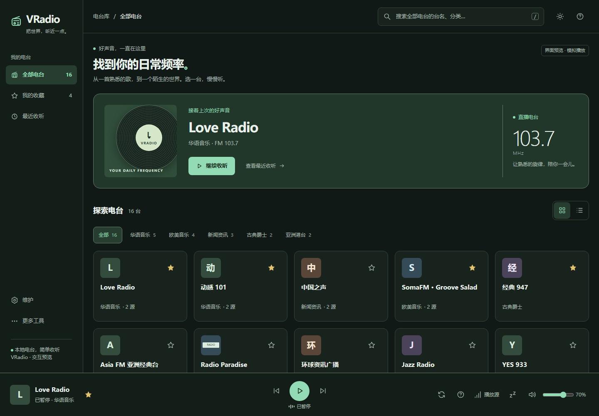

**1280×800**：四列卡片。矮窗口可通过正常页面滚动查看首行与后续，不把首行必须完整出现作为目标；底栏保持固定且末行可完整滚至其上方。

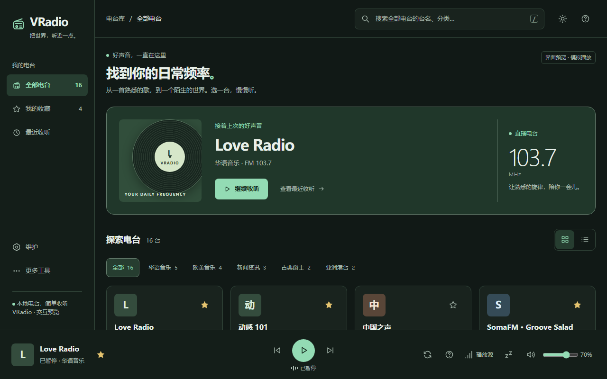

**浅色首页网格**：保持同一信息架构、金色收藏与深绿主动作，不能只替换背景而遗漏边界与文本。

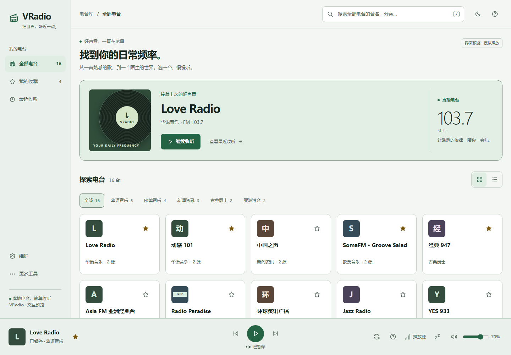

### 14.3 搜索、长名称与列表

**收藏内搜索**：续听/欢迎区隐藏，明确当前范围并提供搜索全部；分类仍可组合。

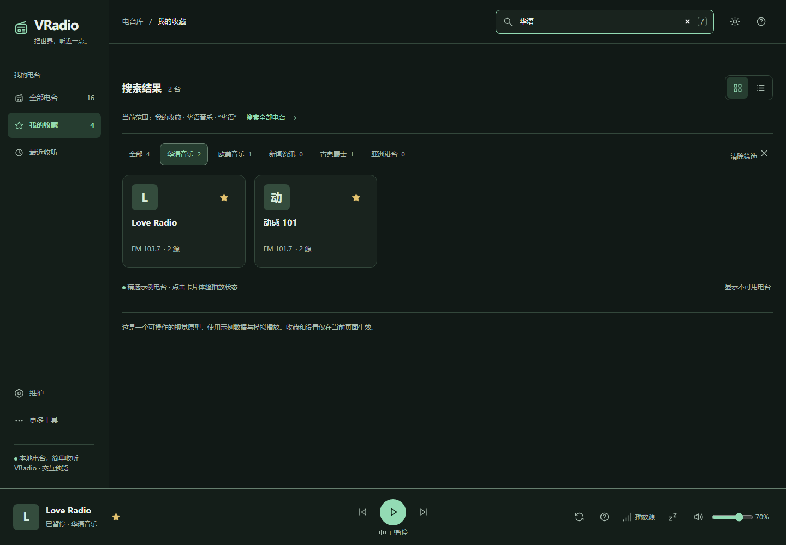

**长名称边界**：卡片logo固定48px，长台名最多两行独立限宽，不塞回logo；完整名称聚焦/悬停提示。

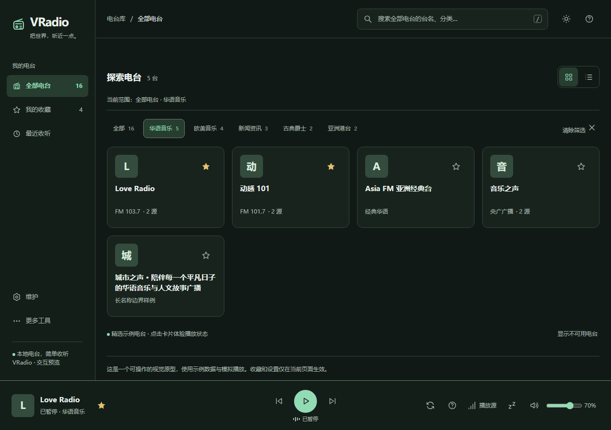

**浅色列表**：单行台名，右侧元信息/收藏，避免旧版列表只收缩到内容宽。

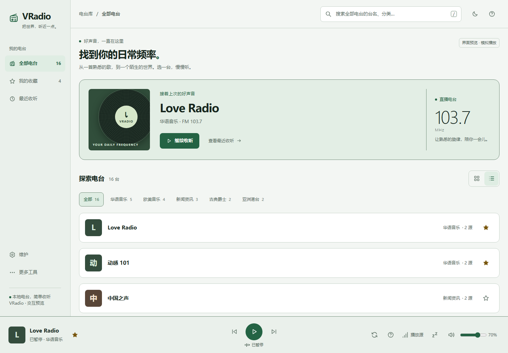

**无结果**：呈现可操作的恢复路径，不只显示“无数据”。

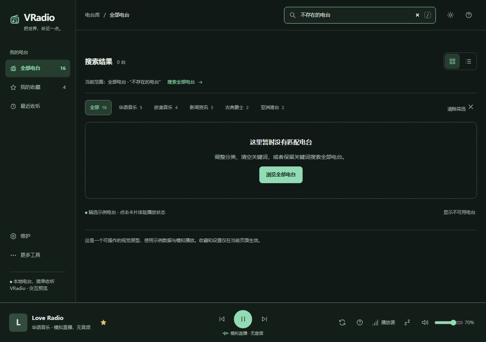

### 14.4 维护、未保存和冲突

**桌面维护草稿**：三区导航，左对象列表，右编辑器，保存/取消属于当前对象；底部状态明确是否有未保存内容。截图包含“模拟他页更新”演示入口，**此测试入口不迁入正式产品**。

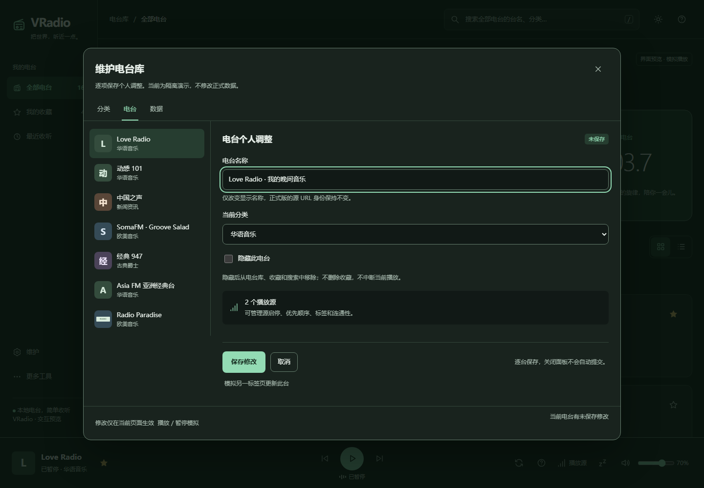

**离开确认**：保存并继续 / 放弃修改 / 继续编辑；Esc等同继续编辑，校验失败不跳转。

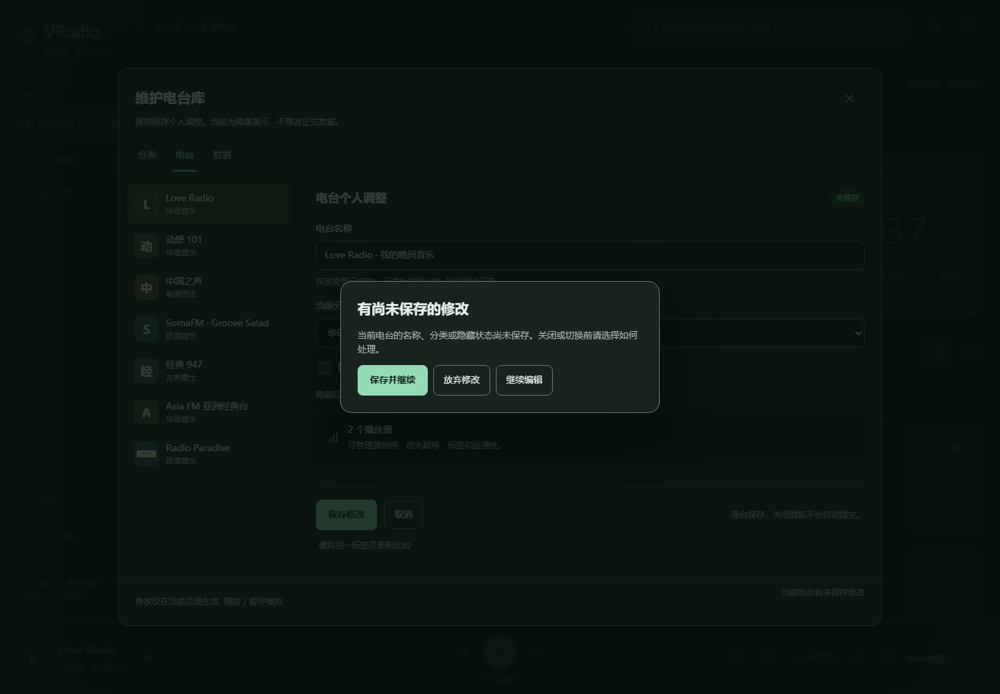

**外部变更冲突**：保留输入，提供重载/明确覆盖；正式版只合并本对象，与Store的LWW限制一致。

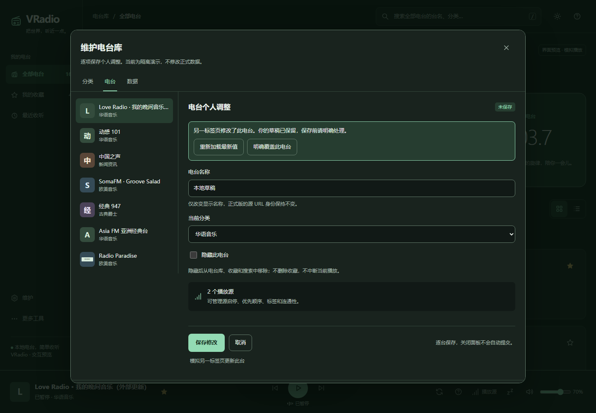

**窄屏维护单列**：共用同一草稿/保存规则；这张图只作为新维护面板的窄屏参考，**不用于替换正式手机日常电台库和播放器布局**。原型的手机浏览壳并非现有正式UI像素复刻。

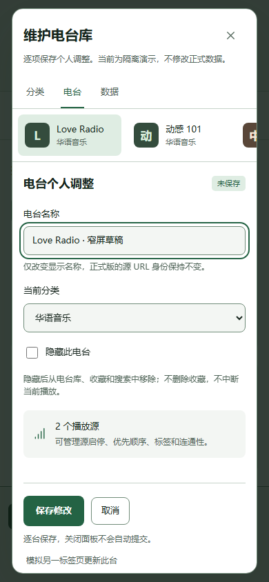

### 14.5 数据与主题

**数据分区**：维护配置与完整备份是独立动作；都须先处理现有草稿。

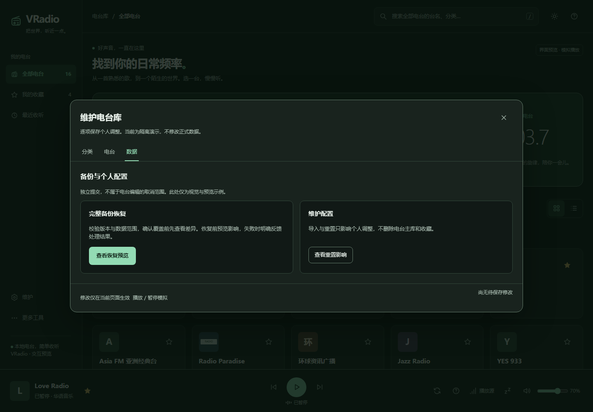

**恢复预览**：仅示意信息层级，未连接备份解析/事务；正式版以B4返回的真实范围、版本、选中sidecar和回滚结果为准，不能拿这张静态表当完整功能。

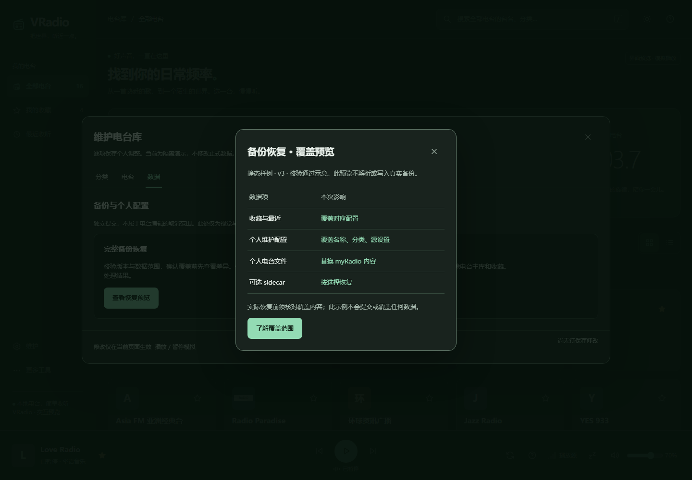

**三态主题**：跟随系统、浅色、深色，选中态明确。

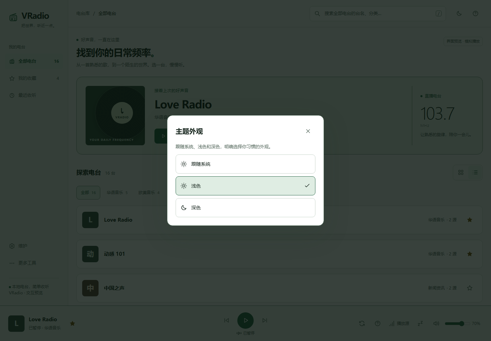

补充播放态图：`12-home-playing-dark.png`，唱片模拟连接成功后进入运行状态。抓图时reduced-motion开启确保静态一致，不能凭静态截图证明真实音频时序；该项由操作断言和正式Player集成验收验证。

## 15. 最终交接审查：能否据此编码交付

### 15.1 结论与条件

**可以作为直接进入编码、拆任务、联调和验收的交接包**：已有项目背景、已确认功能边界、视觉系统/尺寸、页面状态、对象工作流、真实符号接线表、可运行逻辑参考、带操作场景的截图、实施批次及验收清单。接手者不需要重新猜侧栏、续听、搜索、切台和保存语义。

但本文不是完整可直接复制的最终业务源码：B4尚未在本次检查的工作区落地，不能虚构其事务接口；Phase0验证合并基线是明确前置任务。熟悉原生JS的开发者完成基线登记后可执行编码；备份真实提交部分须在B4合并后接线，其他UI开发可按依赖先行。正式交付仍须自己跑真实音频/多标签/浏览器矩阵，不能把demo模拟断言当成正式回归。

### 15.2 功能—骨架—视觉—验收追踪表

| 开发项 | 实现说明/骨架 | 视觉或交互参考 | 必验收项 |
|---|---|---|---|
| 桌面壳与断点 | §3.1、§6.1/6.5 | 图01/02/15 | ≥1024启用，1023保留紧凑，状态不丢 |
| 组合筛选/搜索 | §3.2/3.4、§6.2/6.7 | 图03/13 | F01–F06、最近队序/体检独立范围 |
| 条件动态续听 | §3.3、§6.3 | 图01/12 | 当前/最近/精选/隐藏/空态、无自动播 |
| logo/长名/卡片 | §4.2、§6.5/6.10 | 图14/04 | contain、坏图、两行/单行、全名提示 |
| 播放栏/主题/浮层 | §4.3/4.4、§6.6/6.10 | 图01/05/12 | 可见收藏切台、刷新/音量/来源可达 |
| 维护基本编辑 | §5、§6.4/6.8及handoff-helpers.js | 图06/07/08/11 | M01–M04、草稿/冲突/焦点 |
| 详情和源生命周期 | §6.9、srcorder.js实际接口 | demo详情仅层级参考，正式保持B1完整能力 | 启停/排序/标签/两恢复动作/诊断 |
| 隐藏撤销/重置 | §5.4、§6.4/6.8 | demo维护可操作 | 撤销只改隐藏，不覆盖他页新值 |
| 备份恢复 | §5.5、§7前置核验 | 图09/10仅静态预览 | B4 fixtures/失败回滚，不造平行schema |
| 双布局/键盘 | §6.7、§9 | 图11、demo键盘操作 | roving、快捷键让位、模态栈、跨断点 |

### 15.3 开发任务完成标准

- [ ] 基线清单写明实际commit、B4合并证据、备份符号与srcorder等脚本顺序；npm test通过。
- [ ] P1筛选入口全量迁移；没有再向state.cat写★收藏/最近的遗漏；空态/体检/最近/定位同步。
- [ ] P2/P3桌面按截图与token实现，双主题、四列目标、五列上限、logo/长名与实际dock占位通过。
- [ ] B1现有详情中心、源生命周期、诊断、歌史和入口保留；源动作共用对象草稿，不另造即时保存绕路。
- [ ] P4逐对象草稿、保存校验、取消、离开确认、异步失败、同/异对象多标签更新全部通过；无旧snapshot整份覆盖。
- [ ] P5使用B4事务，预览与实际结果一致，file://降级诚实；重置影响与恢复默认双动作明确。
- [ ] §9回归矩阵和真实音频验证完成；浏览器/设备未测项如实记录，无新npm运行依赖或共享契约漂移。
- [ ] PR交付：实现diff、测试输出、改后截图、启动/回退办法、剩余问题；附最终符号接线表，不能只写“UI优化完成”。

### 15.4 v2.1交接包验证记录（历史，v2.2新增见§16）

- demo：55项浏览器断言通过，15张PNG参考图，Chromium版本见validation.json；320/375/390/414/768/1023/1024/1280/1440/1920宽度无横向溢出；1280四列，≥1024最多五列；无页面异常，无/api/业务请求。
- 文档片段校验：9组JS片段语法解析通过，15个本地引用均存在、Markdown代码围栏成对；确认弹窗助手另经浏览器验证安全初始焦点、Esc返回stay、快速重开后按钮返回save三项通过。
- 文档助手：17项离线断言通过，验证URL唯一回绑、逐对象保存、三选离开、名称校验、冲突重载/覆盖、不覆盖无关对象和不改物理源序。
- npm test：5个测试文件通过，smoke31、diagnostic21、quality14、source-lifecycle21及13键契约三侧比对通过。
- 视觉检查：实际查看深/浅首页、列表、维护、确认、冲突、长名和窄屏维护截图；复查底栏末行可滚入、logo字牌不越界。未声称完成所有文字/状态对比度、读屏或跨浏览器正式合规审核。
- 正式业务源码未改。运行npm test使用项目既有测试隔离/备份还原机制；demo本身不访问Store、my-radio或真实音频。

## 16. 外部review回执与独立复核（v2.2，2026-11-15）

### 16.1 处置结论

大部分review值得采纳，尤其是“保留手机体验不等于继承bug”和基线持续变化提醒；不将其中的平台/DOM推断直接升级为实现要求。本轮只更新实施文档、事实勘误和取证/验证工具，正式Web业务文件与demo均未改。

| Review项 | 处置 | 已写入的位置/理由 |
|---|---|---|
| A1 窄屏列表收缩 | **采纳并复测** | §6.11全局width:100%，P1及§9.2；不能只在桌面media内修 |
| A2 header拥挤与主题收纳 | **采纳问题与theme修法，纠正detail建议** | §6.11：deadBtn出现时可三行；theme移入lowfreq须同步syncThemeUI/三选菜单；detailBtn实际在footer，保留其播放上下文入口 |
| A3 基线过期 | **采纳并更新** | §6.9更新32cc887；§7增加播放事件/平台边界核验；P0+0.5天 |
| A3 “player.js新增B7回听状态机” | **事实不成立，不按此实施** | git差异与B7报告均表明仅Android Spike；Web player.js/app.js/index.html自7784c2a无该变更，Web时移仍不做；§6.10明确不得造第二状态机 |
| B1 AGENTS陈旧 | **部分采纳** | 修掉不存在的peek、修正坏图回退描述；移除模糊文件计数。当前职责表/script顺序已包含srcorder，不存在需要再补一份模块清单的遗漏 |
| B2 验收补齐 | **采纳并细化** | §9.2增加390/768列表可用宽度、390header≤2行（含deadBtn/当前台）；底栏detailBtn另外验证，不能把它记为header行 |
| B3 平面色板已通过 | **独立复算后采纳** | §4.1与contrast-check-v2.js，从当前token表自动读值，24组最低5.194:1；不等于边框/透明/hover/焦点或整页通过 |
| B4 P0增加0.5天 | **采纳** | P0=1–1.5天，总体参考12.5–17.5天；实际等待B4合并另算 |
| C1–C3 既有勘误与工作流认可 | **保留已有实现方向** | 不再新增产品决策；不凭正面评价免除真实集成回归 |
| C4 授权说明重复 | **适度收敛** | 首部说明当前交付，§13保留历史记录；§14只描述截图来源，不再次重复整段授权 |
| C5 历史文档横幅 | **已存在，保留** | docs/plan-ui-redesign.md顶部已有取代/历史参考标识，不重复加第二条 |

没有需要用户重新拍板的当前产品分歧：列表铺满和主题收纳属于既有紧凑布局修复；保留详情入口和不引入Web时移符合已确认范围。若未来真的提出“移动详情入口”或“Web加入回听”，那是新交互/功能需求，应单独讨论，不由本次review推定授权。

### 16.2 独立证据与数值差异

当前HEAD `32cc887`，合并PR #25为Android时移Spike；`git diff 7784c2a..32cc887 -- player.js app.js index.html` 无差异。`docs/timeshift-spike-report.md`明确“Web侧时移仍不做”“Spike未过实机验证”。不能由仓库HEAD前进推断B6/B4或Web回听已落地。

浏览器取证使用新建上下文，`/api/**`全部模拟503，避免访问/修改真实Store或发起体检；只改变内存view和当前台投影，不播放真实音频。详见 [布局证据JSON](ui-redesign-assets/review-v22/layout-evidence.json)。

| 实验（390×844） | 原始观察 | 仅DOM/CSS注入后 | 结论 |
|---|---:|---:|---|
| 列表容器宽度 | 337.47px | 390px | 内容收缩确认；补width有效 |
| 列表行宽度 | 309.47px | 362px | 保留左右14px内边距，不能误要求行本体等于视口宽 |
| header，deadBtn隐藏 | 约102px、两行 | 不需要为复现强称三行 | 回归取决于可见控件，不能把单一场景泛化 |
| header，deadBtn显示 | 约140px、主题独占第三行 | 主题移入lowfreq后约102px、两行 | 主题收纳有实证支持 |
| 选中台后detailBtn显示 | parent=FOOTER | 仍留FOOTER | 不增加header行；另验底栏排列 |

review中的列表315px与本轮337.47px均为内容依赖快照，差值不影响根因判断。header行数以实际布局/截图判定，不以子元素top值的去重数量计算（同一flex行垂直居中可能top不同）。

**问题状态：deadBtn显示、主题落到第三行。**

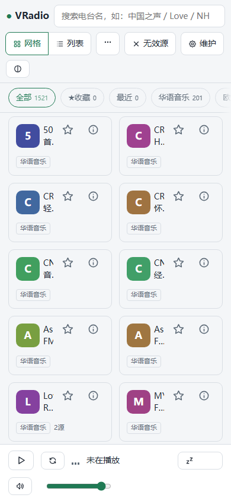

**修法验证：仅移动主题节点后的两行。此图是临时注入取证，不是已经实现的新UI。**

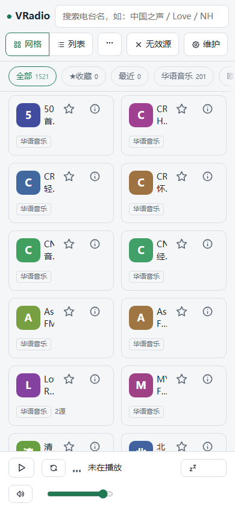

平面色板复核报告：[contrast-results.json](ui-redesign-assets/review-v22/contrast-results.json)。最低项是浅色 `muted/raised` 5.194:1；浅色 `muted/bg`为5.576:1。review提及“最低muted/bg 5.58”只适用于未含raised的子集，应以本次明确的24组表为准。

历史 `contrast-check.js`验证旧方案色值且含一个有意FAIL的旧色块对照，不能直接当v2 CI通过工具；保留历史用途。新 `contrast-check-v2.js`读取主文档当前token、发现失败以非零退出，适合本方案复跑。透明态、背景合成与真实组件对比另按§9实测。

### 16.3 本轮校验记录

- 24组当前token平面配对全部PASS，最低5.194:1；新增独立报告与零依赖复跑脚本。
- 390px实际正式页面通过隔离DOM/CSS实验复现列表收缩、deadBtn条件下header第三行；取证未修改生产文件。
- 对照源码确认detailBtn属于footer；对照git与B7报告确认回听是Android实验范围。
- 文档中10段JavaScript代码骨架语法检查通过，19处本地资源引用均存在，Markdown代码围栏配对完整。
- `node docs/ui-redesign-assets/verify-handoff.cjs`：17项维护/交接助手断言全部通过。
- `node docs/ui-redesign-assets/contrast-check-v2.js`：24组平面配对全部通过。
- `npm test`：5个测试文件、0失败（smoke 31、diagnostic 21、quality 14、source-lifecycle 21，另含13键契约检查）。这些是当前基线与参考助手验证，不代表尚未实施的新UI已通过正式交付验收。
